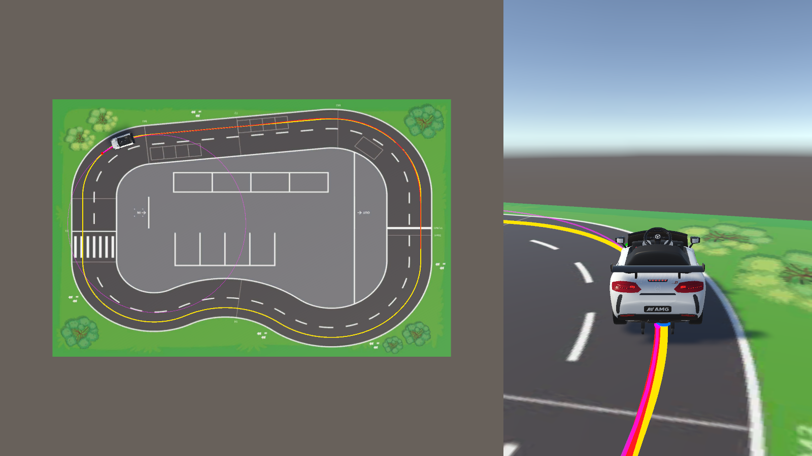
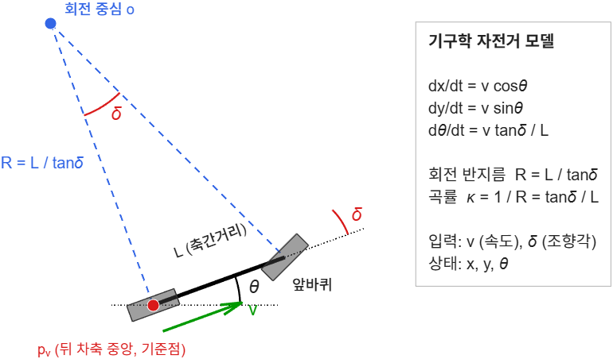
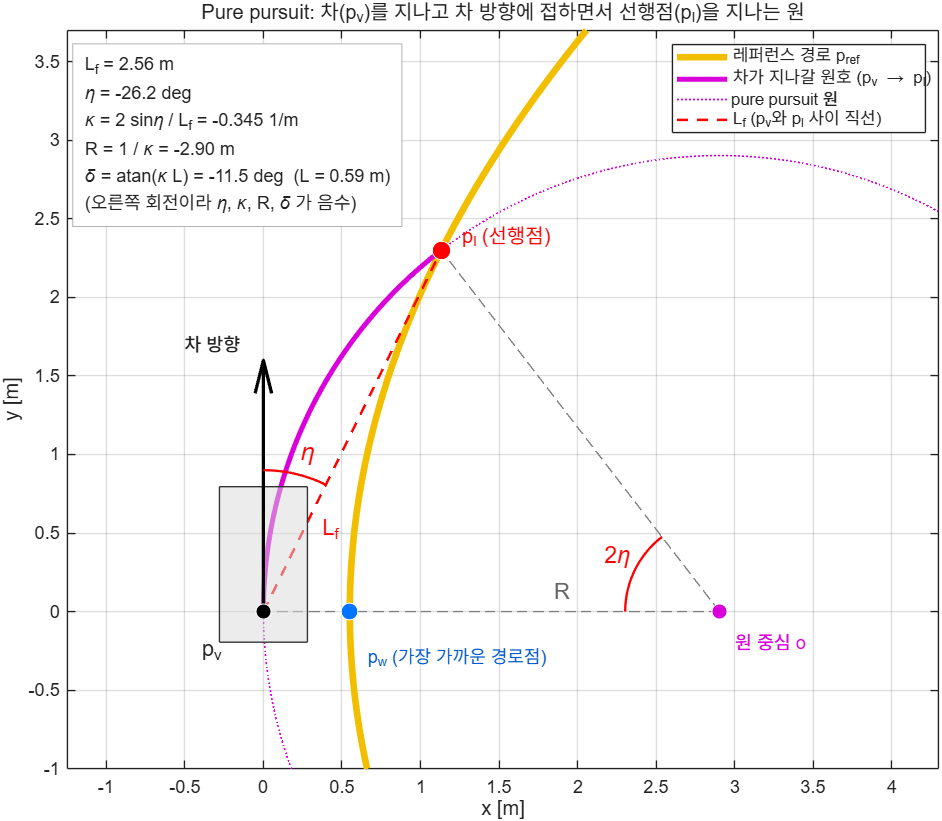
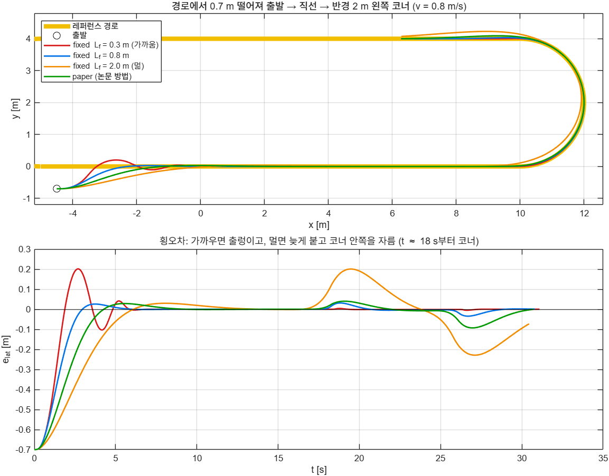
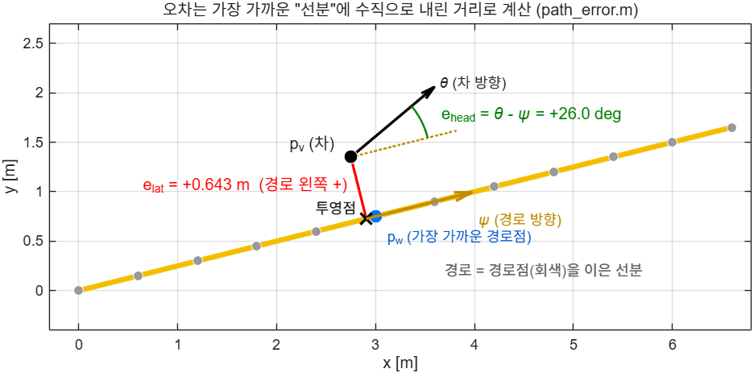
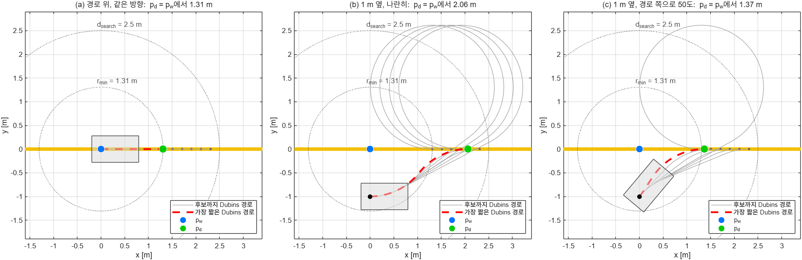
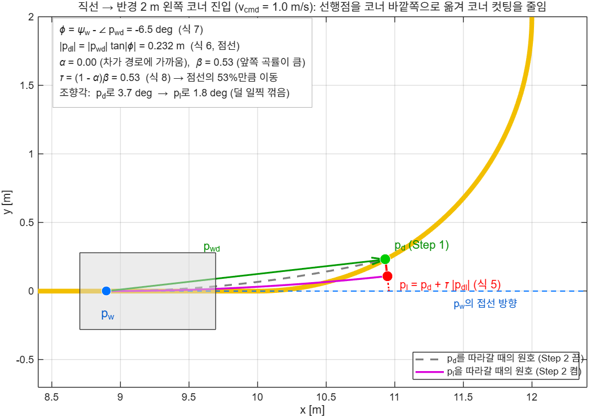
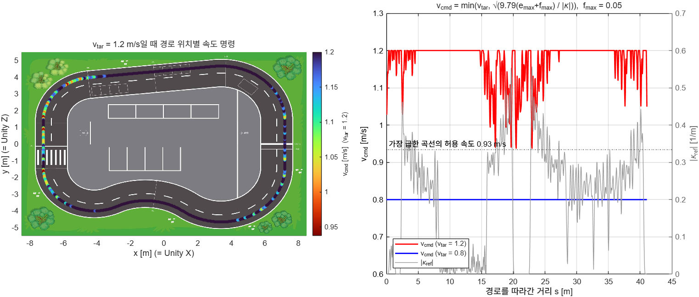
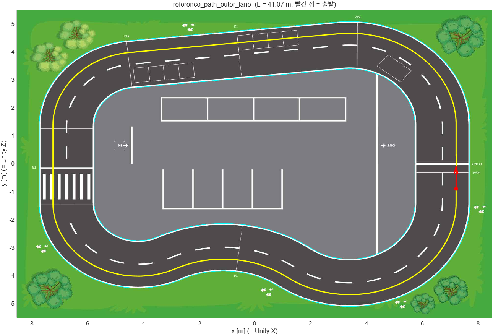
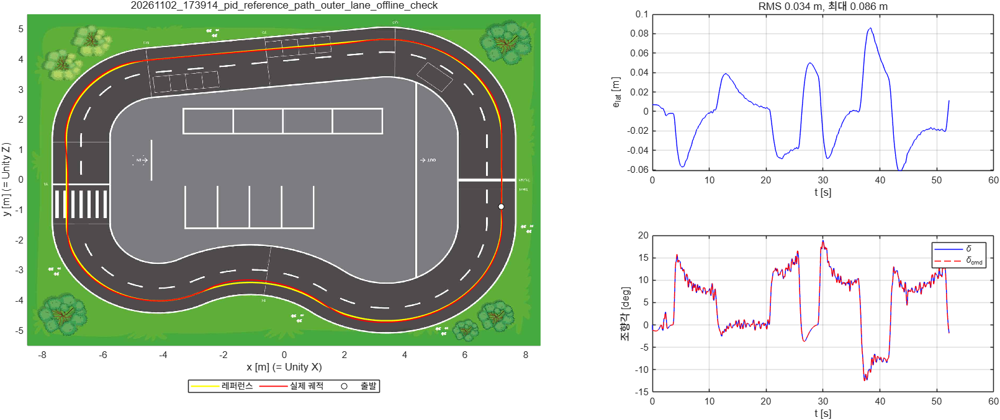

# KIIS 2026 — Pure Pursuit · PID 경로 추종 (MATLAB 제어 + Unity 시각화)

이 프로젝트는 Unity 맵의 차선을 따라 차가 스스로 달리게 합니다. 계산은 모두 MATLAB이 하고, Unity는 결과를 화면에 보여줍니다.
- **MATLAB:** 기구학 자전거 모델로 차를 움직이고, 제어기로 조향각과 속도를 정합니다.
- **논문 구현:** 교수님 논문 *Ahn et al., "Accurate Path Tracking by Adjusting Look-Ahead Point in Pure Pursuit Method", International Journal of Automotive Technology 22(1), 2021* 의 선행점 선택 방법(Step 1, Step 2)을 구현했습니다.
- **비교:** 일반적인 pure pursuit(고정 거리, 속도 비례)와 **같은 차, 같은 경로, 같은 조향식**으로 비교할 수 있습니다.
- **PID 제어:** 시간별 위치·속도 레퍼런스(궤적)를 따라가는 **조향 PID + 속도 PID**도 같은 차·같은 경로 위에 만들었습니다([10장](#10-pid-궤적-추종-조향--속도)).
- **이산 상태공간 모델:** 정해진 경로 위에서 전진은 더블 인테그레이터, 조향은 인테그레이터인 모델을 만들었습니다. Unity에서 키를 누를 때마다 k → k+1로 한 스텝씩 진행합니다([11장](#11-이산-상태공간-모델로-한-스텝씩-주행)).
- **PP_PID 제어 (논문 기반 + D):** Chen et al. (ITSC 2018)의 PP_PI에 D 항을 더했습니다. Pure Pursuit에 PID(선행 오차 P, 횡오차 합 I, 횡오차 변화율 D)를 더하고 Low-pass Filter를 거칩니다. 이산 기구학 자전거 모델 위에서 PP, PID와 비교합니다([12장](#12-pp_pid-조향-제어-pp--pid--low-pass-filter)).


*Unity 분석 화면(Game 창에서 키 5). 왼쪽 Top 뷰에서 노란 선은 레퍼런스 경로, 빨간 선은 실제로 지나간 궤적, 분홍 원은 pure pursuit가 그린 원입니다. 오른쪽은 차 뒤를 따라가는 카메라입니다.*

이 문서는 크게 세 부분입니다.

| 부분 | 장 | 내용 |
|---|---|---|
| 배경 지식 | [1장](#1-배경-지식--처음-보는-사람을-위한-설명) | pure pursuit를 처음 보는 사람을 위한 개념 설명 |
| 참고 자료 | [2장](#2-참고-자료-그림영상코드) | 개념을 이해하기 좋은 그림·영상·GitHub 링크 |
| 구현 가이드 | [3–5장](#3-시스템-구조) | AI 없이 처음부터 하나씩 구현할 수 있도록 파일별로 자세히 설명 |
| PID 제어 | [10장](#10-pid-궤적-추종-조향--속도) | 궤적(시간별 위치·속도) 추종 PID의 개념, 게인 정하는 법, 구현 가이드, 결과 |
| 이산 모델 | [11장](#11-이산-상태공간-모델로-한-스텝씩-주행) | x(k+1) = A x(k) + B u(k) 모델, Unity 키로 한 스텝씩 진행 (키보드 버전 / 자동 버전) |
| PP_PID 제어 | [12장](#12-pp_pid-조향-제어-pp--pid--low-pass-filter) | 조향각 = Lowpass(K_pp δ_pp + δ_p + δ_i + δ_d), K_pp + K_p + K_i + K_d = 1, PP·PID·PP_PID 비교 그래프 |

## 목차
- [0. 한눈에 보기](#0-한눈에-보기)
- [1. 배경 지식 — 처음 보는 사람을 위한 설명](#1-배경-지식--처음-보는-사람을-위한-설명)
- [2. 참고 자료 (그림·영상·코드)](#2-참고-자료-그림영상코드)
- [3. 시스템 구조](#3-시스템-구조)
- [4. 처음부터 구현하기 (단계별 가이드)](#4-처음부터-구현하기-단계별-가이드)
- [5. 실행 방법과 결과 읽기](#5-실행-방법과-결과-읽기)
- [6. 현재 결과](#6-현재-결과)
- [7. 한계와 다음 할 일](#7-한계와-다음-할-일)
- [8. 자주 겪는 문제](#8-자주-겪는-문제)
- [9. 용어 정리](#9-용어-정리)
- [10. PID 궤적 추종 (조향 + 속도)](#10-pid-궤적-추종-조향--속도)
- [11. 이산 상태공간 모델로 한 스텝씩 주행](#11-이산-상태공간-모델로-한-스텝씩-주행)
- [12. PP_PID 조향 제어 (PP + PID + Low-pass Filter)](#12-pp_pid-조향-제어-pp--pid--low-pass-filter)

---

## 0. 한눈에 보기

### 0.1 지금까지 구현한 것
- [x] **차량 모델:** 기구학 자전거 모델 + 조향 속도·가감속 제한 ([`bicycle_step.m`](MATLAB/bicycle_step.m)). 수동 주행과 자동 주행이 같은 모델을 씁니다.
- [x] **레퍼런스 경로:** Unity 맵 이미지에서 바깥 차선 중심선을 자동으로 뽑습니다(41.07 m 한 바퀴, [`extract_lane_path.m`](MATLAB/extract_lane_path.m)).
- [x] **Pure pursuit 제어기:** 선행점 → 원 → 조향각 ([`pursuit_steer.m`](MATLAB/Pure-Pursuit/pursuit_steer.m)).
- [x] **선행점 선택 3가지 모드** ([`select_lookahead.m`](MATLAB/Pure-Pursuit/select_lookahead.m)):
  - `fixed`: 고정 거리
  - `speed`: 속도 비례
  - `paper`: 논문의 Step 1(Dubins) + Step 2(선행점 옮기기)
- [x] **속도 명령:** 논문 4.1절처럼 곡선에서 감속합니다 ([`pure_pursuit_step.m`](MATLAB/Pure-Pursuit/pure_pursuit_step.m)).
- [x] **오차 계산:** 횡오차 e_lat, 방향오차 e_head ([`path_error.m`](MATLAB/path_error.m)).
- [x] **기록:** 매 스텝 44개 값을 CSV/MAT로 저장하고, 요약(평균·RMS·MSE·최대)을 남깁니다 ([`RunLogger.m`](MATLAB/RunLogger.m)).
- [x] **화면:**
  - MATLAB 실시간 그림 (레이어 켜기·끄기, 슬라이더로 파라미터 조절)
  - Unity 오버레이와 분할 화면
- [x] **도구:** 파라미터 일괄 실행 ([`run_sweep.m`](MATLAB/Pure-Pursuit/run_sweep.m)), 단위 테스트 17개 ([`test_pure_pursuit.m`](MATLAB/Pure-Pursuit/test_pure_pursuit.m)).
- [x] **PID 제어기** ([`PID_control.m`](MATLAB/PID/PID_control.m), 10장):
  - 레퍼런스 궤적(시간별 위치·속도): [`make_reference_trajectory.m`](MATLAB/PID/make_reference_trajectory.m)
  - 조향 PID(횡오차) + 속도 PID(앞뒤 위치·속도 오차): [`pid_step.m`](MATLAB/PID/pid_step.m)
  - 테스트 17개: [`test_pid.m`](MATLAB/PID/test_pid.m)
- [x] **이산 상태공간 모델 + 한 스텝씩 주행** (코드는 `test1` 폴더, 11장, [test1 정리 문서](MATLAB/test1/README.md)):
  - 정해진 경로 위: 전진 = 더블 인테그레이터, 조향 = 인테그레이터 ([`path_model_step.m`](MATLAB/test1/path_model_step.m))
  - 키보드 버전(Unity 키로 한 스텝·가속)과 자동 버전(스스로 진행): [`discrete_path_drive.m`](MATLAB/test1/discrete_path_drive.m)
  - Unity → MATLAB 키 전달 ([`StepInput.cs`](KIIS2026_AutoCar/Assets/scripts/test1/StepInput.cs))
  - 테스트 13개: [`test_path_model.m`](MATLAB/test1/test_path_model.m)
- [x] **PP_PID 조향 제어 (논문: Chen et al., ITSC 2018의 PP_PI + D)** (코드는 `blended_control` 폴더, 12장, [blended_control 정리 문서](MATLAB/blended_control/README.md)):
  - 차량 모델: 조향 인테그레이터·전진 더블 인테그레이터 + 기구학 자전거 모델. 차가 경로에서 벗어날 수 있음 ([`bicycle_discrete_step.m`](MATLAB/blended_control/bicycle_discrete_step.m))
  - 조향각 = Lowpass(K_pp δ_pp + K_p e_la + K_i Σe + K_d (e[k] − e[k−1])/T_s), K_pp + K_p + K_i + K_d = 1 ([`blended_steer.m`](MATLAB/blended_control/blended_steer.m), 필터 [`lpf_window.m`](MATLAB/blended_control/lpf_window.m))
  - PP, PID, PP_PID를 같은 가속도로 나란히 계산하고 그래프 3개로 비교, 체크박스로 결과 켜고 끄기: [`blended_discrete.m`](MATLAB/blended_control/blended_discrete.m)
  - 튜닝 파라미터(속도, 선행점 거리, a, K_p, K_i, K_d, ℓ, w_current): [`blended_params.m`](MATLAB/blended_control/blended_params.m) + 실행 중 슬라이더
  - 테스트 16개(1번 = Unity 연동): [`test_blended.m`](MATLAB/blended_control/test_blended.m)

### 0.2 폴더 구조
```
KIIS2026_Unity/
├── README.md                       ← 이 문서
├── docs/
│   ├── pure_pursuit_design.md      설계 문서 (구현 전에 검토한 내용)
│   ├── make_readme_figures.m       이 README의 그림(docs/img)을 만드는 스크립트
│   └── img/                        README 그림
├── MATLAB/
│   ├── pure_pursuit_control.m      ★ 실행 진입점: 준비 → 주행 루프 → 저장
│   ├── pure_pursuit_step.m         제어기 한 스텝: 상태 → (δ_cmd, v_cmd)
│   ├── select_lookahead.m          선행점 고르기 (fixed / speed / paper)
│   ├── pursuit_steer.m             선행점 → 원 → 조향각 (모든 모드 공통)
│   ├── pp_params.m                 제어기 모드·파라미터 기본값
│   ├── vehicle_params.m            차량·시뮬레이션 파라미터
│   ├── bicycle_step.m              차량 모델 한 스텝
│   ├── path_error.m                오차 계산 (e_lat, e_head)
│   ├── load_reference_path.m       레퍼런스 경로 불러오기
│   ├── extract_lane_path.m         맵 이미지에서 차선 중심선 뽑기
│   ├── draw_map.m                  맵 이미지를 월드 좌표로 그리기
│   ├── unity_link.m                Unity와 TCP 통신
│   ├── RunLogger.m                 주행 기록 저장
│   ├── run_sweep.m                 파라미터 여러 값 일괄 실행
│   ├── test_pure_pursuit.m         단위 테스트 17개
│   ├── manual_drive.m              방향키로 직접 운전 (같은 차량 모델)
│   ├── PID_control.m               ★ PID 실행 진입점 (10장)
│   ├── pid_step.m                  PID 한 스텝: 레퍼런스 + 상태 → (δ_cmd, a_cmd)
│   ├── pid_params.m                PID 게인·옵션 기본값
│   ├── make_reference_trajectory.m 경로 → 시간별 위치·속도 레퍼런스(궤적)
│   ├── test_pid.m                  PID 단위 테스트 (17개)
│   ├── test1/                      이산 모델 한 스텝씩 주행 (11장, 실행 전 addpath('test1'))
│   │   ├── README.md               test1 정리 (경로 가정, 이산 모델, 수식, 코드, Unity 방법)
│   │   ├── discrete_path_drive.m   ★ 실행 파일 (키보드 / 자동 버전)
│   │   ├── path_model_matrices.m   이산 모델 행렬 A, B
│   │   ├── path_model_step.m       한 스텝 x(k+1) = A x(k) + B u(k) (입력 한계 포함)
│   │   ├── path_pose.m             경로 위 거리 s → 위치·방향·곡률
│   │   └── test_path_model.m       이산 모델 테스트 (13개)
│   ├── blended_control/            PP_PID 조향 제어: PP + PID + Low-pass Filter, 논문 PP_PI + D (12장)
│   │   ├── README.md               blended_control 정리 (모델, 수식, 그래프, 결과, 해석)
│   │   ├── blended_discrete.m      ★ 실행 파일 (키보드 / 자동 버전, 파라미터 슬라이더)
│   │   ├── blended_params.m        튜닝 파라미터 기본값 (v, Lf, a, Kp, Ki, Kd, Kpp, ell, wcur, Ts, 비교 PID 게인)
│   │   ├── blended_steer.m         PP_PID 한 스텝: Lowpass(K_pp δ_pp + δ_p + δ_i + δ_d) (논문 Eq.3–10 + D)
│   │   ├── pid_steer.m             비교용 PID (PID_control과 같은 횡오차 PID)
│   │   ├── plot_blend_components.m 항별 기여 그림 (blending인지 확인)
│   │   ├── check_live_tuning.m     실행 중 파라미터 변경이 그대로 반영되는지 확인
│   │   ├── lpf_window.m            논문의 Low-pass Filter (Eq.8–9: 창 길이 ℓ, w_current)
│   │   ├── bicycle_discrete_step.m 차량 모델: 인테그레이터 / 더블 인테그레이터 + 기구학 자전거
│   │   ├── bicycle_step.m, path_model_matrices.m, path_model_step.m, path_pose.m   복제본 (원본과 같음)
│   │   ├── test_blended.m          테스트 (16개, 1번 = Unity 연동)
│   │   └── img/                    README 그림
│   ├── reference_path_outer_lane.mat / .csv / .png   레퍼런스 경로
│   └── results/                    실행 1회 = 폴더 1개
└── KIIS2026_AutoCar/               Unity 프로젝트 (Unity 6000.6.0f1)
    └── Assets/
        ├── Scenes/SampleScene.unity
        ├── image.png               맵 텍스처 (월드에서 17 m × 11 m)
        └── scripts/
            ├── CarStateReceiver.cs MATLAB 값을 받아 차를 움직임
            ├── PathOverlay.cs      경로·궤적·선행점·원 그리기
            ├── CameraViews.cs      카메라 배치 5가지
            └── test1/StepInput.cs  이산 모델용 키 입력 → MATLAB (Play 때 자동으로 붙음)
```

### 0.3 빠른 실행
**준비물**

| 항목 | 버전·조건 | 비고 |
|---|---|---|
| MATLAB | R2026a에서 확인 | 기본 기능만으로 대부분 동작 |
| Navigation Toolbox | `paper` 모드 Step 1에 필요 (`dubinsConnection`) | 없으면 `'step1_on', false`로 실행 (8장) |
| Image Processing Toolbox | **필요 없음** | 경로 추출은 기본 함수(`conv2`, `contourc`)로 구현 |
| Unity | 6000.6.0f1 (Unity 6.6) | Unity 없이 MATLAB만으로도 실행 가능 |

**Unity와 함께 실행**
1. Unity Hub에서 `KIIS2026_AutoCar`를 열고 `Assets/Scenes/SampleScene`에서 **Play**를 누릅니다.
2. MATLAB에서 아래를 실행합니다.
   ```matlab
   cd MATLAB
   setup_paths                               % Pure-Pursuit, PID, test1, blended_control 폴더를 경로에 추가 (MATLAB 켤 때마다 한 번)
   pure_pursuit_control                      % paper 모드, 0.8 m/s, 한 바퀴
   ```
   - **test1 구조(정해진 경로 + 이산 상태공간 모델 + 키보드 한 스텝)에 PP·PID를 얹은 버전:**
     - 공통 모델: x[t] = [s, v, δ], u[t] = [a, ω], x[t+1] = A x[t] + B u[t]. 전진은 더블 인테그레이터, 조향은 인테그레이터, 차는 경로 위
     - 기준과 오차: δ_ref[t] = atan(L·κ(s[t])), **e[t] = δ_ref[t] − δ[t]** (reference 조향각 − 현재 조향각)
     - `pp_discrete` (`Pure-Pursuit` 폴더): δ_cmd[t] = atan(2L sin α[t] / L_ad[t])
     - `pid_discrete` (`PID` 폴더): δ_cmd[t] = K_p e[t] + K_I Σ e[j]·T_s + K_d (e[t] − e[t−1]) / T_s (기본 K_p 0.2, K_I 5.0, K_d 0.01, 필터 없음)
     - 조향 인테그레이터 입력: ω[t] = (δ_cmd[t] − δ[t]) / T_s (90°/s 제한)
     - **기본은 키보드 버전**: Unity Game 창에서 Space/→ 한 번 = 한 스텝(T_s = 0.1 s), 스텝 키와 함께 ↑ 가속 / ↓ 감속, Q 종료
     - `'input', 'auto'`면 키 없이 0.8 m/s로 한 바퀴. Unity 없이 돌리려면 `'useUnity', false`
     - 같은 창 오른쪽에 매 스텝 그리고, 끝나면 `results/…/error.png`로 저장
       - 위: **추종 오차** δ_ref − δ (파랑, PID의 입력)와 **명령 오차** δ_cmd − δ (빨강, 제어기 출력 − 실제 조향각). 범례에 각각의 MSE·RMS·최대
       - 아래: δ_ref, δ_cmd, δ
       - `timeseries.csv`에는 `e_ref_rad`, `e_cmd_rad` 두 열
3. Unity Game 창을 클릭하고 **5**를 누르면 분석 화면이 됩니다(1 측면 / 2 Top / 3 추적 / 4 분할 / 5 분석).

**Unity 없이 빠르게 (분석용)**
```matlab
r = pure_pursuit_control('useUnity', false, 'realtime', false, 'showFigure', false);
r.e_lat_rms          % 횡오차 RMS [m]
```

**모드·파라미터 바꾸기**
```matlab
pure_pursuit_control('mode', 'fixed', 'Lf', 1.0)
pure_pursuit_control('mode', 'paper', 'v_tar', 1.0, 'alpha_max', 2)
```

**PID로 실행 (10장)**
```matlab
PID_control                                  % Unity 연결, 실시간, 그림
PID_control('useUnity', false, 'realtime', false, 'showFigure', false)   % 빠른 오프라인
```

**이산 모델로 한 스텝씩 (11장, Unity Play 먼저)**
```matlab
addpath('test1')                             % 이산 모델 코드는 MATLAB/test1 폴더에 있음 (한 번만)
discrete_path_drive                          % 키보드 버전: Unity Game 창에서 ↑를 누른 채 Space로 가속하며 한 스텝
discrete_path_drive('input', 'auto')         % 자동 버전: 스스로 진행, P 일시정지
```

**PP_PID 제어 (12장, setup_paths 뒤, Unity Play 먼저)**
```matlab
blended_discrete                             % 키보드 버전: Unity Game 창에서 ↑를 누른 채 Space로 출발
blended_discrete('input', 'auto')            % 자동 버전: 0.8 m/s로 한 바퀴
blended_discrete('input', 'auto', 'useUnity', false, 'Kp', 0.02, 'Kd', 0.002, 'ell', 4)   % Unity 없이, 게인·필터 바꾸기
```
- `'useUnity', false`면 Unity 차는 움직이지 않고 MATLAB 그림만 움직입니다.
- 자동 버전은 기본으로 실제 속도로 진행합니다(한 바퀴 약 52 s). 빨리 끝내려면 `'realtime', false`를 붙이세요.

**테스트**
```matlab
test_pure_pursuit                            % 17 / 17 passed 가 나와야 함
test_pid                                     % 17 / 17 passed 가 나와야 함
test_path_model                              % 13 / 13 passed 가 나와야 함 (addpath('test1') 뒤)
test_blended                                 % 16 / 16 passed (setup_paths 뒤, Unity Play 먼저: 1번에서 Unity 차가 한 바퀴 끝까지 감, 약 90 s)
test_blended('unity', false)                 % Unity 없이: 15 / 15 passed
```

---

## 1. 배경 지식 — 처음 보는 사람을 위한 설명

### 1.1 경로 추종(path tracking)이란
사람이 운전할 때를 생각해 보면 이렇습니다. 도로 위에 "따라가야 할 선"(차선 중앙)이 있고, 운전자는 그 선에서 벗어나지 않도록 **핸들(조향각)과 페달(속도)만** 조작합니다.
자율주행의 **경로 추종**도 같습니다. 세 가지가 있습니다.

| 구성 요소 | 이 프로젝트에서 | 하는 일 |
|---|---|---|
| **레퍼런스 경로** (reference path) | 바깥 차선 중심선, 1 cm 간격 점 4107개 | "어디로 가야 하는가" |
| **제어기** (controller) | pure pursuit | 지금 상태와 경로를 보고 **조향각 δ, 속도 v 명령**을 만듦 |
| **차량** (plant) | 기구학 자전거 모델 | 명령을 받아 실제로 움직임 → 새 상태 |

```
   레퍼런스 경로 ─┐
                  ▼
   ┌──▶ [제어기: pure pursuit] ──(δ_cmd, v_cmd)──▶ [차량 모델] ──┐
   │                                                              │
   └────────────── 현재 상태 (x, y, θ, v, δ) ◀────────────────────┘
```

**중요:** 경로는 **명령을 계산하는 데에만** 쓰입니다. 차를 경로 위에 바로 옮겨 놓는 일은 없습니다.
- 차는 오직 조향각과 속도 명령으로만 움직입니다.
- 그래서 경로와 실제 궤적 사이에 오차가 생깁니다.
- 이 오차(횡오차)를 줄이는 것이 제어기의 목표입니다.
- 논문도 같은 구조입니다. 2.1절은 "pure pursuit는 선행점을 계산해 경로 p_ref를 추종한다"고 하고, 4.1절은 "제어기는 조향각과 속도를 계산한다"고 합니다.

### 1.2 차량 모델: 기구학 자전거 모델


**자전거 모델인 이유:** 실제 차는 바퀴가 4개지만, 왼쪽·오른쪽 바퀴를 가운데 하나로 합치면 앞바퀴 하나, 뒷바퀴 하나인 "자전거"가 됩니다. 저속에서 바퀴가 미끄러지지 않는다고 가정하면, 차의 움직임은 아래 세 식으로 충분히 설명됩니다(논문 식 1).

$$\dot{x} = v\cos\theta,\qquad \dot{y} = v\sin\theta,\qquad \dot{\theta} = \frac{v\tan\delta}{L}$$

| 기호 | 뜻 | 단위·약속 |
|---|---|---|
| (x, y) | **뒤 차축 중앙** p_v의 위치 | m |
| θ (코드에서 `yaw`) | 차 방향 | rad, +x축에서 반시계가 + |
| v | 속도 | m/s, 전진 + |
| δ (코드에서 `delta`) | 앞바퀴 조향각 | rad, **왼쪽이 +** |
| L | 축간거리 (앞·뒤 바퀴 사이) | 0.59 m (Unity 차에서 측정) |

**식의 의미:**
- 앞의 두 식은 "차 방향으로 v만큼 간다"는 뜻입니다.
- 세 번째 식은 조향각에서 회전 속도가 나오는 관계입니다.
  - 앞바퀴를 δ만큼 꺾으면, 그림처럼 두 바퀴의 수직선이 만나는 **회전 중심 o**를 중심으로 반지름 **R = L / tan δ**인 원을 돕니다.
  - 원을 속도 v로 돌면 방향 변화율은 v / R = v tan δ / L 입니다.
- **곡률** κ = 1/R은 "얼마나 휘어 있는가"이고, **κ = tan δ / L**입니다. 조향각과 곡률이 일대일로 대응하는 것이 pure pursuit의 핵심입니다.

**기준점이 뒤 차축인 이유:** 뒤 차축 중앙은 옆으로 미끄러지지 않고 항상 차 방향으로만 움직입니다. 그래서 식이 가장 간단해집니다. 논문도, 이 프로젝트의 Unity 차(car 오브젝트의 기준점)도 뒤 차축 중앙을 씁니다.

**컴퓨터에서 계산하는 법:** 0.02초(50 Hz)마다 아래처럼 조금씩 더합니다(오일러 적분).
```
x ← x + v cosθ · dt
y ← y + v sinθ · dt
θ ← θ + (v tanδ / L) · dt
```

**실제 차처럼 만드는 제한(액추에이터):**
- 핸들은 순간적으로 꺾이지 않습니다. 조향각은 **최대 ±30°이고**, 바뀌는 속도는 **최대 초당 90°입니다**.
- 속도도 순간적으로 변하지 않습니다. 가속 **1.0 m/s²**, 감속 **2.0 m/s²**입니다.

### 1.3 Pure pursuit의 핵심 아이디어
사람은 운전할 때 바로 앞 바닥이 아니라 **조금 앞의 한 점**을 보고 그쪽으로 핸들을 돌립니다. Pure pursuit는 이것을 그대로 수식으로 만든 방법입니다(Coulter, 1992).



**매 스텝 하는 일은 세 가지뿐입니다.**
1. **선행점 p_l 고르기:** 경로 위에서 차보다 조금 앞(거리 약 L_f)에 있는 점을 고릅니다.
2. **원 그리기:** "차(p_v)를 지나고, 지금 차 방향에 접하고, 선행점(p_l)을 지나는 원"은 **딱 하나**입니다. 이 원을 따라가면 차는 선행점에 도착합니다.
3. **조향각 계산:** 그 원을 돌려면 조향각이 얼마여야 하는지 계산합니다.

**2번 원의 곡률 구하기 (논문 식 2):**
- η = 차 방향과, 차에서 선행점으로 가는 직선 사이의 각입니다.
- 원의 **접선**(차 방향)과 **현**(p_v→p_l 직선) 사이의 각은 그 현에 대한 **중심각의 절반**입니다(접선-현 각 정리). 그래서 중심각은 **2η**입니다.
- 삼각형 (o, p_v, p_l)은 두 변이 R인 이등변삼각형입니다. 밑변 L_f는 **L_f = 2R sin η**입니다.
- 정리하면:

$$\kappa = \frac{1}{R} = \frac{2\sin\eta}{L_f}$$

**3번 조향각 (논문 식 3):** 1.2절의 κ = tan δ / L 에 넣으면

$$\delta = \tan^{-1}(\kappa L) = \tan^{-1}\!\left(\frac{2L\sin\eta}{L_f}\right)$$

**그림 속 예:**
- L_f = 2.56 m, η = −26.2°입니다(선행점이 오른쪽에 있어서 음수).
- 그러면 κ = −0.345 1/m, R = −2.90 m(오른쪽으로 도는 원), δ = −11.5°입니다.
- 매 스텝 선행점이 새로 정해지므로, 차는 원을 끝까지 돌지 않고 원의 **시작 방향만** 계속 따라갑니다.

**부호 약속(이 프로젝트 전체):** 왼쪽이 +입니다. η > 0이면 선행점이 왼쪽에 있고, κ > 0, R > 0, δ > 0(왼쪽으로 꺾음)이 됩니다.

### 1.4 선행 거리 L_f의 딜레마
Pure pursuit의 성능은 **선행점을 어디에 찍느냐**로 거의 정해집니다. 아래 그림은 같은 차, 같은 경로, 같은 조향식에서 **선행 거리만 바꿔** 돌린 결과입니다(이 프로젝트 코드로 계산).



| L_f | 일어나는 일 | 이유 |
|---|---|---|
| **너무 가까움** (빨강, 0.3 m) | 경로에 빨리 붙지만 **지나쳐서 출렁임** | 위치만 맞추고 방향을 고려하지 않아서, 경로에 도착할 때 이미 방향이 크게 틀어져 있음 |
| 적당함 (파랑, 0.8 m) | 부드럽게 붙고 코너도 잘 돎 | — |
| **너무 멂** (주황, 2.0 m) | **늦게** 붙고, 코너에서 **안쪽을 자름**(약 0.2 m) | 선행점이 이미 코너 안에 있으면, 차가 직선 구간에서부터 미리 꺾음 (**코너 컷팅**) |

논문 2.2절이 지적하는 두 가지 한계가 바로 이것입니다.
1. 안정성과 추종 성능 사이의 트레이드오프
2. 코너 컷팅

그래서 선행점을 고르는 방법이 여러 가지 나왔습니다.

| 모드 (`pp.mode`) | 선행점 고르는 법 | 출처 |
|---|---|---|
| `fixed` | 경로를 따라 고정 거리 L_f 앞 | 기본 pure pursuit |
| `speed` | L_f = t_la · v (최소·최대로 자름) | 논문의 "Proportional to Speed" (Kuwata 2008) |
| `paper` | Step 1(Dubins 경로) + Step 2(코너 바깥으로 옮기기) | **논문 제안 방법** |

세 모드는 **선행점 고르는 부분만** 다르고, 원 → 조향각 계산(1.3절)은 모두 같습니다. 그래서 비교가 공정합니다.

### 1.5 오차 정의와 성능 지표


| 이름 | 정의 | 코드 |
|---|---|---|
| **횡오차 e_lat** (cross-track error) | 차(p_v)에서 경로 **선분**까지 수직 거리. 경로 진행 방향 기준 **왼쪽이 +** | `e.e_lat` |
| **방향오차 e_head** | 차 방향 θ − 경로 방향 ψ (−π~π로 정리) | `e.e_head` |
| p_w | 차에서 가장 가까운 경로점 | `e.idx`, `e.x_w`, `e.y_w` |

**선분에 투영하는 이유:** 경로점 사이 간격만큼 오차가 계단처럼 튀지 않게 하려고, 가장 가까운 "점"이 아니라 "선분"에 수직으로 내립니다. 이 정의는 제어기와 독립적인 공용 함수 하나([`path_error.m`](MATLAB/path_error.m))로 두었습니다. 나중에 PID와 비교할 때도 같은 정의를 씁니다.

**한 번 주행의 성능 지표**(`summary.txt`에 자동 계산). N은 기록된 스텝 수, e_k는 k번째 스텝의 횡오차입니다.

| 지표 | 식 | 의미 |
|---|---|---|
| 평균 \|e\| | (1/N) Σ \|e_k\| | 평균적으로 얼마나 벗어났나 |
| MSE | (1/N) Σ e_k² | 큰 오차에 더 큰 벌점 |
| RMS | √MSE | MSE를 m 단위로 |
| 최대 \|e\| | max \|e_k\| | 차선 이탈 여부 판단 (이 맵의 차선 여유는 한쪽 약 14 cm) |

### 1.6 논문 방법 (Ahn et al., 2021)
논문은 pure pursuit의 **조향식(1.3절)은 그대로** 둡니다. 대신 **선행점을 고르는 방법**을 두 단계로 바꿨습니다.

| 단계 | 하는 일 | 해결하는 문제 |
|---|---|---|
| **Step 1** | Dubins 경로 길이로 경로 위의 선행점 **p_d**를 고름 | 경로 밖에서 출발할 때 출렁임 없이 빨리 붙기 |
| **Step 2** | 코너에 들어갈 때 p_d를 경로 **밖(코너 바깥쪽) p_l**로 옮김 | 코너 컷팅 |

#### Dubins 경로란
- 출발 자세(위치+방향)와 도착 자세를 잇는 **가장 짧은 길**입니다.
- 조건은 "최소 회전 반지름 r_min보다 급하게 돌 수 없다"는 것입니다(Dubins, 1957).
- 답은 항상 "원호-직선-원호" 또는 "원호-원호-원호" 꼴이고, **6종류**(RSR, RSL, LSR, LSL, RLR, LRL; R=오른쪽, L=왼쪽, S=직진)뿐입니다.
- **논문에서는 따라갈 경로가 아니라 p_d를 고르는 잣대로만** 씁니다.
- MATLAB에서는 Navigation Toolbox의 `dubinsConnection`으로 계산합니다.

#### 속도에 따른 최소 회전 반지름 (논문 식 4)
도로 설계 기준(AASHTO)의 "속도-곡선 반지름" 관계를 씁니다.

$$r_{min}(v_{cmd}) = \frac{v_{cmd}^2}{9.79\,(e_{max} + f_{max})}$$

- e_max = 0(도로 경사 없음), f_max = 0.05(마찰 계수)입니다.
- 이 값은 차량 최소 회전반경(1.02 m)과 상한 r_up(우리 2.5 m, 논문 12 m) 사이로 자릅니다.
- 0.8 m/s이면 r_min = 1.31 m입니다. **빠를수록 선행점이 멀어집니다.**

#### Step 1: Dubins 길이가 가장 짧은 경로점 = p_d (논문 Algorithm 1)
1. 차에서 가장 가까운 경로점 **p_w**를 찾습니다.
2. p_w보다 앞쪽 경로점 중 p_w와의 직선 거리가 **r_min 이상, d_search 이하**인 점들을 후보로 둡니다.
3. 각 후보 i까지 Dubins 경로 길이를 계산합니다.
   - 출발 자세: (x, y, **θ + δ**) — 지금 앞바퀴가 향한 방향
   - 도착 자세: (x_i, y_i, **ψ_i**) — 그 점의 경로 방향
4. **길이가 가장 짧은 후보를 p_d**로 합니다.



- **(a) 경로 위에서 같은 방향일 때:** Dubins 길이는 그냥 직선 거리입니다. 그래서 가장 가까운 후보, 곧 **r_min 앞**이 p_d가 됩니다. 이때는 "L_f = r_min인 fixed 모드"와 같습니다.
- **(b) 1 m 옆에서 나란히 달릴 때:** 가까운 후보로 가려면 고리(회색 원)를 그려야 해서 길이가 깁니다. 그래서 **더 먼 점**(2.06 m)이 뽑힙니다. 결과적으로 부드러운 S자로 접근하고 출렁이지 않습니다.
- **(c) 경로 쪽으로 50° 틀어져 있을 때:** 바로 붙을 수 있으니 **가까운 점**(1.37 m)을 고릅니다. 경로에 닿을 때 방향이 맞춰집니다.

#### Step 2: 코너에 들어갈 때 선행점을 바깥으로 (논문 식 5–10)
- **문제:** 직선에서 코너로 들어갈 때 p_d는 이미 코너 위에 있습니다. p_d를 그대로 따라가면 차가 미리 꺾어서 안쪽을 자릅니다.
- **해결:** p_d를 **p_w의 접선 쪽**(코너 바깥)으로 옮긴 p_l을 따라갑니다.



| 식 | 내용 | 의미 |
|---|---|---|
| 식 7 | φ = ψ_w − ∠p_wd | p_w의 접선과 p_w→p_d 사이 각 (논문은 θ로 씀) |
| 식 6 | \|p_dl\| = \|p_wd\| · tan\|φ\| | p_d에서 이만큼 수직으로 가면 **정확히 p_w 접선 위** |
| 식 9 | α = min(\|p_v − p_w\| / α_max, 1) | 차가 경로에 가까울수록 0 |
| 식 10 | β = 0 (cur_pw ≥ cur_pd일 때), 아니면 min((cur_pd − cur_pw) / β_max, 1) | **앞쪽(p_d) 곡률이 더 클 때만**(코너 진입) 커짐 |
| 식 8 | τ = (1 − α) β | 옮기는 정도 (0 = 안 옮김, 1 = 접선까지) |
| 식 5 | p_l = p_d + τ \|p_dl\| (cos θ_pdl, sin θ_pdl) | 최종 선행점 |

- **τ가 커지는 때:** τ는 "경로에 붙어 있고(α≈0) 코너에 들어갈 때(β>0)"만 커집니다. 직선 주행이나 코너를 빠져나올 때는 0이라 p_l = p_d입니다.
- **그림 예:** τ = 0.53만큼 옮겼습니다. 조향각이 3.7°에서 1.8°로 줄어 **덜 일찍 꺾습니다**.

> **구현 주의 — 식 6의 부호:**
> - 논문 식 6(θ_pdl = θ_pwd − sign(θ)·π/2)에 식 7의 정의를 그대로 넣으면 p_l이 그림 4와 **반대쪽**(코너 안쪽)으로 갑니다.
> - 이 프로젝트는 기하적으로 맞는 **θ_pdl = ∠p_wd + sign(φ)·π/2**를 씁니다. p_l이 p_w 접선 쪽에 놓이도록 하는 식입니다.
> - 테스트(`corner: p_l moved outward`)로 확인했습니다.
> - 곡률 비교(β)는 좌·우 코너가 섞인 맵이라 **크기**(\|κ\|)로 합니다.

#### 속도 명령 (논문 4.1절)
"차가 곡선 위에 있거나 선행점이 곡선 위에 있으면, AASHTO 속도-반지름 관계로 v_cmd를 계산하고, 아니면 최대 목표 속도"를 씁니다. 식 4를 v에 대해 풀면 됩니다.

$$v_{cmd} = \min\!\left(v_{tar},\ \sqrt{\frac{9.79\,(e_{max}+f_{max})}{|\kappa|}}\right)$$



- **지금 설정에서는 감속이 걸리지 않습니다:** 우리 경로에서 가장 급한 곡선(반지름 1.78 m)도 허용 속도가 0.93 m/s입니다. 그래서 **기본 v_tar = 0.8 m/s에서는 감속이 일어나지 않습니다**(파랑).
- **감속이 걸리는 경우:** v_tar가 0.93보다 클 때(예: 1.2, 빨강)만 곡선 구간에서 내려갑니다.
- **v_cmd가 오르내리는 이유:** 빨간 선이 자잘하게 오르내리는 것은 이미지에서 뽑은 경로의 곡률에 약 0.35 m 간격의 물결이 있기 때문입니다(7장).

#### 논문 값 → 우리 차 크기에 맞춘 값
논문 차(Hyundai HG240, 축간거리 약 2.85 m)와 우리 차(0.59 m)의 비율은 약 0.21입니다. 길이 파라미터는 줄이고, 곡률 파라미터는 키웠습니다.

| 파라미터 | 논문 | 이 프로젝트 | 이유 |
|---|---|---|---|
| e_max, f_max | 0, 0.05 | 0, 0.05 | 횡가속도 한계(9.79×0.05 ≈ 0.49 m/s²)는 차 크기와 무관 |
| r_min 상한 r_up | 12 m | 2.5 m | 맵이 17 m × 11 m |
| 후보 탐색 거리 d_search | 12 m | 2.5 m | 같은 이유 |
| α_max | 5 m | 1.0 m | 길이 × 0.21 |
| β_max | 0.2 1/m | 0.95 1/m | 곡률 ÷ 0.21 |
| 목표 속도 v_tar | 1.33–5.55 m/s | 0.8 m/s | 차 최고속도 1.5 m/s |
| 경로점 간격 | 0.01 m | 0.01 m | 같음 |

---

## 2. 참고 자료 (그림·영상·코드)

아래 링크는 모두 2026-11-02에 열어서 확인했습니다. GitHub 별 수는 그날 기준입니다.

> **주의 — 로봇 자료와 우리 차의 차이:**
> - 많은 튜토리얼(MathWorks `controllerPurePursuit`, Purdue SIGBots, MATLAB 로봇 예제 등)은 **바퀴 두 개로 도는 로봇**(차동 구동)용입니다. 이런 자료는 조향각 대신 **각속도 ω**를 출력합니다.
> - 우리 차(자전거 모델)에 쓰려면 δ = atan(ω·L / v)로 바꾸거나, 1.3절의 δ = atan(2L sinη / L_f)를 바로 쓰면 됩니다.
> - 선행점을 고르는 개념(L_f, η, 원)은 똑같습니다.

### 2.1 추천 학습 순서
| 순서 | 자료 | 왜 |
|---|---|---|
| 1 | [논문 영상](https://youtu.be/1nRdlEsYopY) | 만들 목표(논문 방법이 기존 방법보다 코너를 잘 도는 모습)를 먼저 눈으로 보기 |
| 2 | [WikiDocs 인터랙티브 시뮬레이션 (한국어)](https://wikidocs.net/340966) | 선행 거리 슬라이더를 움직여 출렁임·코너 컷팅을 직접 보기 (1.4절) |
| 3 | [Algorithms for Automated Driving — 자전거 모델](https://thomasfermi.github.io/Algorithms-for-Automated-Driving/Control/BicycleModel.html) → [Pure Pursuit](https://thomasfermi.github.io/Algorithms-for-Automated-Driving/Control/PurePursuit.html) | 그림으로 식을 한 단계씩 유도 (1.2–1.3절) |
| 4 | [PythonRobotics `pure_pursuit.py`](https://github.com/AtsushiSakai/PythonRobotics/blob/master/PathTracking/pure_pursuit/pure_pursuit.py) | 약 300줄짜리 전체 구현. MATLAB으로 한 줄씩 옮겨 보기 좋음 |
| 5 | [Snider 2009 보고서](https://www.ri.cmu.edu/pub_files/2009/2/Automatic_Steering_Methods_for_Autonomous_Automobile_Path_Tracking.pdf) 그림 11–13 | 선행 거리에 따른 출렁임 vs 코너 컷팅 (논문이 푸는 문제) |
| 6 | [Wikipedia Dubins path](https://en.wikipedia.org/wiki/Dubins_path) → [Giese 튜토리얼](https://gieseanw.wordpress.com/2012/10/21/a-comprehensive-step-by-step-tutorial-to-computing-dubins-paths/) | Step 1에 필요한 Dubins 경로 |
| 7 | [논문 원문](https://doi.org/10.1007/s12239-021-0013-7) | 위를 다 보고 나면 Step 1·2가 쉽게 읽힘 |

### 2.2 영상
| 영상 | 채널 | 수준 | 내용 |
|---|---|---|---|
| [Accurate Path Tracking by Adjusting Look Ahead Point in Pure Pursuit Method](https://youtu.be/1nRdlEsYopY) | joonwoo ahn (논문 저자) | 중급 | 논문의 실제 차량 실험 영상 |
| [F1TENTH L10 – Pure Pursuit](https://www.youtube.com/watch?v=x9s8J4ucgO0) | xLAB for Safe Autonomous Systems | 입문–중급 | 대학 강의 한 편. 경로 계획 → 제어 흐름과 pure pursuit ([강의 페이지](https://f1tenth-coursekit.readthedocs.io/en/latest/lectures/ModuleD/lecture10.html)) |
| [Self-Driving Cars – Lecture 6.3 Geometric Control](https://www.youtube.com/watch?v=A-RdRUMhOEU) | Tübingen Machine Learning (Andreas Geiger) | 중급 | 기하 기반 횡방향 제어 강의 (제목만 확인). 같은 강좌 [5.2 Kinematic Bicycle Model](https://www.youtube.com/watch?v=D4AgX1zjx54) |
| [Vehicle Dynamics & Control – 05 Kinematic bicycle model](https://www.youtube.com/watch?v=HqNdBiej23I) | Prof. Georg Schildbach (Univ. Lübeck) | 중급 | 자전거 모델 판서 유도 (Kong 2015 공저자) |
| [Vehicle Path Tracking Using Pure Pursuit Controller](https://www.mathworks.com/videos/vehicle-path-tracking-using-pure-pursuit-controller-1595330917925.html) | MathWorks (10분) | 입문–중급 | Simulink 예제: 선행 거리 조절, 코너 감속 ([예제 모델](https://github.com/mathworks/vehicle-pure-pursuit)) |
| [Dubin's Paths](https://www.youtube.com/watch?v=fEImNJQ3hUM) | gieseanw | 중급 | Dubins 경로 계산 설명 (아래 Giese 튜토리얼 저자) |
| [Introduction to Self-Driving Cars](https://www.coursera.org/learn/intro-self-driving-cars) | Coursera, Univ. of Toronto | 입문–중급 | Module 4-2 자전거 모델, Module 6-2 pure pursuit. 수강 등록 필요 |

### 2.3 그림이 좋은 설명 자료
| 자료 | 언어 | 수준 | 내용 |
|---|---|---|---|
| [로봇 시뮬레이션 2-1. Pure Pursuit](https://wikidocs.net/340966) (WikiDocs) | 한국어 | 입문 | **페이지 안에서 바로 돌아가는 시뮬레이션**. 자전거 모델 차, 선행 거리·속도 슬라이더, 8자/직각/S자 경로 |
| [Pure Pursuit](https://velog.io/@jshyunn/Pure-Pursuit) (velog, jshyunn) | 한국어 | 입문 | L_d, α, R 기하 그림과 식 유도, 작은 C++ 클래스 |
| [Pure Pursuit & Stanley](https://velog.io/@kroad2020/Pure-Pursuit-Stanely) (velog, K-ROAD) | 한국어 | 입문 | 자전거 모델 → pure pursuit → Stanley를 그림으로 비교 |
| [Pure Pursuit](https://blog.phan.kr/posts/Pure-Pursuit/) (blog.phan.kr) | 한국어 | 입문 | 자전거 모델·pure pursuit 그림, 선행 거리별 MATLAB 비교 그래프 |
| [Pure Pursuit 제어기](https://kr.mathworks.com/help/nav/ug/pure-pursuit-controller.html) (MathWorks) | 한국어/영어 | 입문 | 선행점 그림, 선행 거리가 작으면 출렁이고 크면 코너를 자른다는 설명 |
| [Algorithms for Automated Driving: Pure Pursuit](https://thomasfermi.github.io/Algorithms-for-Automated-Driving/Control/PurePursuit.html) | 영어 | 입문 | 조향각을 바꿔 가며 호가 목표점에 닿는 그림 → 사인법칙 유도. **우리와 같은 차량형(자전거) 설정** |
| [Basic Pure Pursuit](https://wiki.purduesigbots.com/software/control-algorithms/basic-pure-pursuit) (Purdue SIGBots) | 영어 | 입문 | 선행 원 그림, 원-선분 교점 4가지 경우, 애니메이션, 빈칸/정답 Python 연습문제 (차동 구동) |
| [Coulter 1992, Implementation of the Pure Pursuit Path Tracking Algorithm](https://www.ri.cmu.edu/pub_files/pub3/coulter_r_craig_1992_1/coulter_r_craig_1992_1.pdf) | 영어 | 중급 | pure pursuit 원조 보고서 ([소개 페이지](https://www.ri.cmu.edu/publications/implementation-of-the-pure-pursuit-path-tracking-algorithm/)) |
| [Snider 2009, Automatic Steering Methods for Autonomous Automobile Path Tracking](https://www.ri.cmu.edu/pub_files/2009/2/Automatic_Steering_Methods_for_Autonomous_Automobile_Path_Tracking.pdf) | 영어 | 중급 | 그림 9–10 자전거 모델·pure pursuit 기하, **그림 11–13 선행 거리 효과**, Stanley 비교 |
| [Adaptive Pure Pursuit Controller](https://www.chiefdelphi.com/uploads/default/original/3X/b/e/be0e06de00e07db66f97686505c3f4dde2e332dc.pdf) (FRC Team 1712) | 영어 | 중급 | 실전 레시피: 경로점 보간, 3점으로 곡률 계산, 곡률로 감속, 의사코드 (그림은 적음) |
| [controllerPurePursuit](https://www.mathworks.com/help/nav/ref/controllerpurepursuit-system-object.html) (MathWorks) | 영어 | 입문 | MATLAB 내장 pure pursuit. 내 구현과 결과를 비교할 때 참고 (차동 구동 출력) |

### 2.4 코드 (GitHub)
| 저장소 | 언어 | 별 | 볼 파일 | 내용 |
|---|---|---|---|---|
| [AtsushiSakai/PythonRobotics](https://github.com/AtsushiSakai/PythonRobotics) | Python | 약 30.8k | `PathTracking/pure_pursuit/pure_pursuit.py` | 뒤 차축 기준 자전거 모델 + 속도 비례 선행 거리 + PID 속도 제어. [애니메이션 GIF가 있는 설명 페이지](https://atsushisakai.github.io/PythonRobotics/modules/6_path_tracking/pure_pursuit_tracking/pure_pursuit_tracking.html) |
| 〃 | Python | 〃 | `PathPlanning/DubinsPath/dubins_path_planner.py` | Dubins 경로 6종류 계산. [그림·GIF 설명 페이지](https://atsushisakai.github.io/PythonRobotics/modules/5_path_planning/dubins_path/dubins_path.html) |
| [ShisatoYano/AutonomousVehicleControlBeginnersGuide](https://github.com/ShisatoYano/AutonomousVehicleControlBeginnersGuide) | Python | 약 1.9k | `src/components/control/pure_pursuit/` | **초보자용**으로 만든 깔끔한 구조, 단위 테스트, 주행 GIF |
| [ai-winter/matlab_motion_planning](https://github.com/ai-winter/matlab_motion_planning) | MATLAB | 약 650 | `local_planner/rpp_plan.m`, `curve_generation/dubins_curve.m` | 툴박스 없는 순수 MATLAB 코드 (모델은 차동 구동) |
| [ros-navigation/navigation2 — Regulated Pure Pursuit](https://github.com/ros-navigation/navigation2/tree/main/nav2_regulated_pure_pursuit_controller) | C++ | 약 5.0k | `src/regulated_pure_pursuit_controller.cpp` | 실제 로봇 제품 수준 변형: 속도 비례 선행 거리, 곡률 기반 감속. [설정 문서](https://docs.nav2.org/jazzy/configuration_and_development/configuration_guide/controller_plugins/configuring_regulated_pp/), [논문(arXiv)](https://arxiv.org/abs/2305.20026) |
| [mathworks/vehicle-pure-pursuit](https://github.com/mathworks/vehicle-pure-pursuit) | MATLAB/Simulink | 약 34 | `Models/...slx` | 위 MathWorks 영상의 예제 모델 (여러 툴박스 필요) |
| [AndrewWalker/Dubins-Curves](https://github.com/AndrewWalker/Dubins-Curves) | C/C++ | 약 330 | — | 널리 쓰이는 Dubins 라이브러리 ([Python 래퍼](https://github.com/AndrewWalker/pydubins)) |

### 2.5 차량 모델과 Dubins 경로
| 자료 | 수준 | 내용 |
|---|---|---|
| [Algorithms for Automated Driving: Kinematic Bicycle Model](https://thomasfermi.github.io/Algorithms-for-Automated-Driving/Control/BicycleModel.html) | 입문 | 회전 중심, 애커만 조향, 자전거 모델을 그림으로 한 단계씩 (1.2절과 같은 내용) |
| [bicycleKinematics](https://www.mathworks.com/help/robotics/ref/bicyclekinematics.html) (MathWorks) | 입문 | MATLAB 내장 자전거 모델. 직접 만든 `bicycle_step`과 비교용 |
| Kong et al. 2015, *Kinematic and Dynamic Vehicle Models for Autonomous Driving Control Design* — [DOI](https://doi.org/10.1109/IVS.2015.7225830), [제3자 사본 PDF](https://nuhuo08.github.io/control/IV_KinematicMPC_jason.pdf) | 중급–심화 | 기구학 자전거 모델의 표준 인용 논문. 저속에서 충분히 정확하다는 근거 |
| [Dubins path](https://en.wikipedia.org/wiki/Dubins_path) (Wikipedia) | 입문 | 6종류(RSR, RSL, LSR, LSL, RLR, LRL) 정의와 그림 |
| [A Comprehensive, Step-by-Step Tutorial to Computing Dubin's Paths](https://gieseanw.wordpress.com/2012/10/21/a-comprehensive-step-by-step-tutorial-to-computing-dubins-paths/) (Andy Giese) | 중급 | 원 사이 접선 구하기부터 6종류 길이 계산까지 그림으로. 직접 Dubins를 구현하고 싶을 때 |
| [dubinsConnection](https://www.mathworks.com/help/nav/ref/dubinsconnection.html) (MathWorks) | 입문 | 이 프로젝트가 쓰는 함수. `connect`, `show`, `interpolate` 예제 |
| [How to make Dubins Paths in Unity with C#](https://www.habrador.com/tutorials/unity-dubins-paths/2-basic-dubins-paths/) (Habrador) | 중급 | 회전 원과 접선 그림, Unity C# 코드로 6종류 계산·LineRenderer로 그리기 |

### 2.6 논문
- **Ahn, Shin, Kim, Park, "Accurate Path Tracking by Adjusting Look-Ahead Point in Pure Pursuit Method"**, *International Journal of Automotive Technology* 22(1), pp. 119–129, 2021.
  - [doi.org/10.1007/s12239-021-0013-7](https://doi.org/10.1007/s12239-021-0013-7)
  - 원문은 학교 계정이 필요할 수 있습니다.
  - 저자가 공개한 코드는 없습니다.
- **함께 보면 좋은 논문:**
  - Macenski et al., *Regulated Pure Pursuit for Robot Path Tracking*, Autonomous Robots 2023 ([arXiv:2305.20026](https://arxiv.org/abs/2305.20026)). 선행 거리와 속도를 조절하는 다른 방향의 개선으로, 논문 방법과 비교해 보기 좋습니다.

---

## 3. 시스템 구조

### 3.1 누가 무엇을 하나
| | MATLAB | Unity |
|---|---|---|
| 역할 | **모든 계산**: 차량 모델, 제어기, 오차, 기록 | **표시만**: 받은 위치로 차를 옮기고 선을 그림 |
| 물리 | 기구학 자전거 모델 (`bicycle_step`) | 쓰지 않음 (Rigidbody를 kinematic으로 둠) |
| 주기 | 고정 dt = 0.02 s (50 Hz) | 받은 최신 값으로 매 프레임 갱신 |
| 통신 | TCP **클라이언트** (`tcpclient`) | TCP **서버** 127.0.0.1:55001 |

**MATLAB이 계산의 기준인 이유:** 같은 파라미터면 Unity가 있든 없든, 실시간이든 아니든 **결과가 완전히 같습니다**(재현 가능). 그래서 Unity 없이 빠르게 수백 번 돌려 파라미터를 비교할 수 있습니다.

### 3.2 함수 호출 관계
```
pure_pursuit_control.m (실행 진입점)
├── vehicle_params.m          차량 파라미터
├── pp_params.m               제어기 모드·파라미터
├── load_reference_path.m     경로 (← extract_lane_path.m이 미리 만들어 둔 .mat)
├── unity_link.m              Unity 연결·전송
├── RunLogger.m               기록 (→ draw_map.m으로 결과 그림)
└── 매 스텝 반복
    ├── path_error.m          오차, 최근접점 p_w
    ├── pure_pursuit_step.m   제어기
    │   ├── (speedCommand)    속도 명령
    │   ├── select_lookahead.m  선행점 (모드별)
    │   └── pursuit_steer.m     원 → 조향각
    └── bicycle_step.m        차량 모델
```

### 3.3 좌표·단위 약속
| 항목 | 약속 |
|---|---|
| 위치 | MATLAB x = Unity X, MATLAB y = Unity Z. 원점 = Plane(맵) 중심 |
| 방향 | yaw(θ)는 +x축에서 반시계 +. **Unity Rotation Y = 90° − yaw** (Unity는 +Z가 0°, 시계 방향 +) |
| 조향 | δ 왼쪽 +. Unity 바퀴 회전은 오른쪽 +라서 **−δ**로 돌림 |
| 단위 | 길이 m, 각도 rad(코드 안), 속도 m/s |
| 맵 | Plane 10 m × Scale (1.7, 1.1) = **17 m × 11 m**. 텍스처는 월드에서 **180° 돌아가 있음** |
| 차 기준점 | Unity `car` 오브젝트의 위치 = 뒤 차축 중앙 = 모델의 (x, y) |

### 3.4 TCP 메시지 (MATLAB → Unity, 한 줄 = 쉼표로 구분한 숫자)
**상태 줄 (매 스텝).** 앞 9개는 수동 주행과 공통이고, pure pursuit는 12개를 더 보냅니다. 값이 없으면 NaN입니다.

| 번호(0부터) | 0 | 1 | 2 | 3 | 4 | 5 | 6 | 7 | 8 |
|---|---|---|---|---|---|---|---|---|---|
| 값 | t | x | y | yaw | v | delta | yawRate | e_lat | e_head |

| 번호 | 9 | 10 | 11 | 12 | 13 | 14 | 15 | 16 | 17 | 18 | 19 | 20 |
|---|---|---|---|---|---|---|---|---|---|---|---|---|
| 값 | x_w | y_w | x_d | y_d | x_l | y_l | x_c | y_c | R | Lf | tau | delta_cmd |

**특수 줄 (시작할 때 한 번)**
- `RESET`: Unity가 그리던 궤적을 지웁니다.
- `PATH,n,x1,y1,x2,y2,...`: 레퍼런스 경로를 보냅니다(표시용으로 5 cm 간격으로 줄임).

---

## 4. 처음부터 구현하기 (단계별 가이드)
이 장은 **AI 없이 처음부터 직접 구현하는 사람**을 위한 안내입니다. 아래 순서대로 만들면 각 단계에서 바로 확인하면서 진행할 수 있습니다.

| 단계 | 만들 것 | 확인 방법 |
|---|---|---|
| 0 | 데이터 약속 정하기 | — |
| 1 | `vehicle_params.m` | 값 출력 |
| 2 | `bicycle_step.m` | 일정 조향각 → 원을 그리는지 |
| 3 | 레퍼런스 경로 (`stadium` 테스트 경로 → `extract_lane_path.m`) | 맵 위에 그려 보기 |
| 4 | `path_error.m` | 경로 왼쪽/오른쪽 점의 부호 |
| 5 | `pursuit_steer.m` | 원 경로에서 δ = atan(L/R) |
| 6 | `select_lookahead.m` (fixed → speed → paper) | 직선/원/코너 테스트 |
| 7 | `pp_params.m`, `pure_pursuit_step.m` | 속도 규칙 테스트 |
| 8 | `test_pure_pursuit.m` | 17개 통과 |
| 9 | `pure_pursuit_control.m` (메인 루프) | 오프라인으로 한 바퀴 |
| 10 | `RunLogger.m` | 결과 폴더 확인 |
| 11 | Unity 연결 (`unity_link.m` + C# 3개) | Unity에서 차가 움직이는지 |
| 12 | `manual_drive.m`, `run_sweep.m` | 키보드 운전, 비교표 |

> **팁:**
> - 아래 코드 블록은 실제 파일에서 가져왔습니다. 설명에 필요 없는 주석은 일부 생략하거나 설명용 주석을 덧붙였으니, 전체는 링크된 파일을 보세요.
> - 각 단계를 만든 직후 그 단계의 "확인 방법"을 꼭 해 보세요.
> - 나중에 한꺼번에 돌리면, 어디서 틀렸는지 찾기가 매우 어렵습니다.
> - 특히 **부호(왼쪽 +)와 각도 단위(rad)** 실수가 가장 흔합니다.

### 단계 0. 데이터 약속 정하기
함수끼리 주고받는 값을 **구조체 4개**로 통일했습니다. 이 약속만 지키면 각 함수를 따로 만들고 따로 테스트할 수 있습니다.

| 구조체 | 필드 | 만드는 곳 → 쓰는 곳 |
|---|---|---|
| `st` 차량 상태 | `t, x, y, yaw, v, delta, yawRate` | `bicycle_step` → 제어기·기록·Unity |
| `u` 명령 | `delta_cmd, v_cmd` | 제어기 → `bicycle_step` |
| `ref` 경로 | `x, y, s, psi, kappa`(열벡터), `N, ds, L, closed, name` | `load_reference_path` → 모두 |
| `e` 오차 | `idx, x_w, y_w, x_proj, y_proj, s, psi, kappa, e_lat, e_head` | `path_error` → 제어기·기록 |

- 파라미터는 `p`(차량, `vehicle_params`)와 `pp`(제어기, `pp_params`) 두 개입니다.
- 제어기 내부값(선행점, 원 등)은 `dbg` 구조체로 모아 기록과 Unity 표시에 씁니다.

### 단계 1. 차량 파라미터 — [`vehicle_params.m`](MATLAB/vehicle_params.m)
**목표:** 차량 숫자를 한 곳에 모읍니다. 여러 파일에 같은 숫자를 복사해 두면, 한쪽만 고쳐지는 실수가 생깁니다.

```matlab
function p = vehicle_params()
p.L         = 0.59;          % 축간거리 [m]  (Unity: Wheel_FL z - Wheel_RL z = -0.30 - (-0.89))
p.vMax      = 1.5;           % 최고 속도 [m/s]
p.vRevMax   = 0.5;           % 최고 후진 속도 [m/s]
p.accel     = 1.0;           % 가속도 [m/s^2]
p.brake     = 2.0;           % 감속도 [m/s^2]
p.deltaMax  = deg2rad(30);   % 최대 조향각 [rad]
p.steerRate = deg2rad(90);   % 조향 속도 [rad/s]
p.Rmin      = p.L / tan(p.deltaMax);   % 최소 회전반경 [m] (= 1.02 m)
p.dt = 0.02;                 % 계산·전송 주기 [s] (50 Hz)
p.mapHalfX = 10 * 1.7 / 2;   % 맵 절반 크기 (Plane 10 m x Scale)
p.mapHalfY = 10 * 1.1 / 2;
p.startUnity = [7.20, -0.89, 0];   % 출발: Unity car의 Position X, Position Z, Rotation Y
p.unityIP   = "127.0.0.1";
p.unityPort = 55001;
end
```
- **축간거리를 재는 법:** Unity Hierarchy에서 앞바퀴(`Wheel_FL`)와 뒷바퀴(`Wheel_RL`)의 z 위치 차이를 봅니다.
- **각도 단위:** 코드 안에서는 **항상 rad**를 씁니다(`deg2rad`).

### 단계 2. 차량 모델 — [`bicycle_step.m`](MATLAB/bicycle_step.m)
**목표:** 명령 u를 받아 dt 뒤의 상태를 돌려주는 함수 `st = bicycle_step(st, u, p, dt)`를 만듭니다.

```matlab
function st = bicycle_step(st, u, p, dt)
%% 액추에이터: 조향각은 조향 속도로, 속도는 가속/감속도로 제한
deltaCmd = min(max(u.delta_cmd, -p.deltaMax), p.deltaMax);      % ① 명령을 한계 안으로
st.delta = moveToward(st.delta, deltaCmd, p.steerRate * dt);    % ② 한 스텝에 최대 90°/s × dt 만큼만

vCmd = min(max(u.v_cmd, -p.vRevMax), p.vMax);
if vCmd * st.v >= 0 && abs(vCmd) > abs(st.v)
    rate = p.accel;      % 같은 방향으로 빨라질 때
else
    rate = p.brake;      % 느려지거나 방향을 바꿀 때
end
st.v = moveToward(st.v, vCmd, rate * dt);

%% 기구학 자전거 모델 (오일러 적분)
st.yawRate = st.v / p.L * tan(st.delta);
st.x   = st.x + st.v * cos(st.yaw) * dt;
st.y   = st.y + st.v * sin(st.yaw) * dt;
st.yaw = atan2(sin(st.yaw + st.yawRate * dt), cos(st.yaw + st.yawRate * dt));   % -pi ~ pi
st.t   = st.t + dt;
end

function out = moveToward(cur, target, maxStep)
% cur를 target 쪽으로 최대 maxStep만큼 이동
out = cur + max(-maxStep, min(maxStep, target - cur));
end
```
**설명**
- **`moveToward`:** "목표까지 한 번에 최대 maxStep만 움직인다"는 함수입니다. 조향 속도 제한과 가감속 제한을 이것 하나로 만듭니다.
- **위치 갱신 순서:** x, y는 **갱신 전의 yaw**로 계산합니다(오일러 적분). yaw를 먼저 바꾸면 결과가 조금 달라집니다.
- **`atan2(sin(a), cos(a))`:** 각도를 −π~π로 정리하는 관용구입니다. 이렇게 하지 않으면 몇 바퀴 돈 뒤 yaw가 10π 같은 값이 되어 각도 차 계산이 틀어집니다.

**확인 방법:** 조향각 0.3 rad, 속도 0.5 m/s로 200스텝을 돌리면 yawRate = 0.5·tan(0.3)/0.59 = **0.2621 rad/s**가 되어야 합니다. 궤적을 `plot`하면 반지름 L/tan(0.3) = 1.91 m인 원이 나와야 합니다.

**흔한 실수:**
- deg와 rad를 섞어 씀
- 후진(v < 0)에서 가속·감속 판정이 반대로 됨 — `vCmd * st.v >= 0` 조건을 확인하세요.

### 단계 3. 레퍼런스 경로
#### 3-1. 경로 데이터 형식
경로는 **1 cm 간격의 점들**입니다. 한 바퀴 닫힌 경로(폐루프)라서 마지막 점 다음은 첫 점입니다.

| 필드 | 뜻 |
|---|---|
| `x, y` | 점 위치 [m] |
| `s` | 첫 점부터 경로를 따라간 거리 [m] |
| `psi` | 그 점의 경로 방향 [rad] |
| `kappa` | 그 점의 곡률 [1/m] (왼쪽으로 휘면 +) |
| `N, ds, L` | 점 개수, 간격(0.01), 한 바퀴 길이 |

> **처음 구현할 때는 맵 대신 간단한 테스트 경로부터 쓰세요.**
> - [`test_pure_pursuit.m`](MATLAB/Pure-Pursuit/test_pure_pursuit.m)의 `stadium`(직선 + 반원 경기장)과 `makeRef`(s, ψ, κ 계산) 함수를 그대로 쓰면 됩니다.
> - 직선·원에서는 정답을 손으로 계산할 수 있어서 디버깅이 훨씬 쉽습니다.

**ψ와 κ 계산 (중심 차분, `makeRef`와 `extract_lane_path`가 같은 방식):**
```matlab
h = 10;                                              % 앞뒤 10점(10 cm)으로 미분 → 잡음 줄이기
ip = mod((0:N-1)' + h, N) + 1;  im = mod((0:N-1)' - h, N) + 1;   % 폐루프라 인덱스를 순환
dx  = (x(ip) - x(im)) / (2*h*ds);       dy  = (y(ip) - y(im)) / (2*h*ds);
ddx = (x(ip) - 2*x + x(im)) / (h*ds)^2; ddy = (y(ip) - 2*y + y(im)) / (h*ds)^2;
psi   = atan2(dy, dx);
kappa = (dx .* ddy - dy .* ddx) ./ (dx.^2 + dy.^2).^1.5;        % 곡선의 곡률 공식
```

#### 3-2. 맵 이미지에서 차선 중심선 뽑기 — [`extract_lane_path.m`](MATLAB/extract_lane_path.m)
Unity 맵 텍스처(`KIIS2026_AutoCar/Assets/image.png`, 1949×1462 px)에서 **바깥 차선의 중심선**을 자동으로 뽑습니다. Image Processing Toolbox 없이 기본 함수만 씁니다.


*하늘색 = 도로의 바깥/안쪽 가장자리, 노란 선 = 뽑은 차선 중심선(41.07 m), 빨간 점·화살표 = 출발 위치와 방향*

**1) 색으로 도로 찾기:** 아스팔트(진회색)와 흰 페인트를 RGB 값으로 구분합니다.
```matlab
I = double(imread(opt.imageFile));
mx = max(I, [], 3); mn = min(I, [], 3); avg = mean(I, 3);
asphalt = (mx - mn) < 20 & avg > 55 & avg < 105;     % 채도 낮고 어두운 회색
white   = mn > 200;                                  % 세 채널 모두 밝음
road = closeMask(asphalt, 10);                       % 점선·표시선·횡단보도 틈 메우기
road = road | (white & dilateMask(road, 8));         % 가장자리 흰 실선까지 포함
road = closeMask(road, 3);
```
- **`dilateMask`(팽창):** 원판 모양 커널과 `conv2`로 만듭니다.
- **`closeMask`(닫힘):** 팽창 후 침식입니다. 침식 = "반전 → 팽창 → 반전"으로 만듭니다.
- 이것으로 Image Processing Toolbox의 `imclose`를 대신합니다.

**2) 경계선 두 개:** `contourc(double(road), [0.5 0.5])`로 도로 마스크의 윤곽선을 얻고, 가장 긴 두 개를 바깥/안쪽 가장자리로 씁니다. `contourc` 출력은 `[레벨, 점 개수; x..., y...]` 블록이 이어진 형식이라 반복문으로 나눕니다.

**3) 픽셀 → 월드 좌표:** 텍스처가 월드에서 180° 돌아가 있어서, 이미지 왼쪽 위가 월드의 (+X, −Z) 쪽입니다.
$$x = 8.5 - 17\,\frac{p_x + 0.5}{1949},\qquad y = -5.5 + 11\,\frac{p_y + 0.5}{1462}$$
가로·세로 축척(0.0087 / 0.0075 m/px)이 달라서, **반드시 월드 좌표로 바꾼 뒤** 거리를 계산합니다.

**4) 차선 중심:** 차선이 두 개(폭이 같음)이므로, 바깥 차선의 중심은 도로 폭의 1/4 지점입니다.
```matlab
center = outer + 0.25 * (nearestIn - outer);   % 안쪽 차선은 0.75
```

**5) 다듬기:** 폐루프용 가우시안 스무딩(양 끝을 이어 붙여 `smoothdata`) → 0.01 m 간격으로 다시 샘플링(`interp1 ... 'spline'`) → ψ, κ를 계산하고 κ도 약하게 스무딩합니다.

**6) 출발점 맞추기:** Unity 차 위치 (7.20, −0.89)에 가장 가까운 점을 첫 점으로 옮기고(`circshift`), 경로 방향이 차 방향과 반대면 뒤집습니다(κ 부호도 함께 뒤집음).

**확인 방법:** 실행하면 아래처럼 출력됩니다. 그림(`reference_path_outer_lane.png`)에서 노란 선이 차선 가운데에 있는지 눈으로 봅니다.
```
[reference_path_outer_lane] 점 4107개, 한 바퀴 41.07 m, |kappa| 최대 0.561 1/m (반경 1.78 m), 차선 폭 0.84~0.98 m
  출발 위치 (7.20, -0.89)에서 횡오차 0.007 m
```
가장 급한 곡선(반경 1.78 m)이 차 최소회전반경(1.02 m)보다 완만해야 주행할 수 있습니다.

**관련 파일:**
- [`draw_map.m`](MATLAB/draw_map.m): 맵 이미지를 월드 좌표에 맞춰 깝니다(`image`의 XData를 뒤집어 180° 회전을 맞춤).
- [`load_reference_path.m`](MATLAB/load_reference_path.m): 저장된 `.mat`(또는 `.csv`)을 `ref` 구조체로 읽습니다.

### 단계 4. 오차 계산 — [`path_error.m`](MATLAB/path_error.m)
**목표:** `e = path_error(ref, x, y, yaw, hint)`를 만듭니다. 차에서 가장 가까운 경로점(p_w)과 횡오차·방향오차를 구합니다.

```matlab
N = ref.N;
if nargin < 5 || isempty(hint) || isnan(hint)
    cand = (1:N)';                                   % 처음: 전체에서 찾기
else
    nBack = round(0.5 / ref.ds);                     % 이후: 직전 위치의 뒤 0.5 m ~ 앞 2 m만
    nFwd  = round(2.0 / ref.ds);
    cand  = mod(hint - 1 + (-nBack:nFwd)', N) + 1;
end
d2 = (ref.x(cand) - x).^2 + (ref.y(cand) - y).^2;
[d2min, k] = min(d2);
if ~(nargin < 5 || isempty(hint) || isnan(hint)) && d2min > 2.0^2
    cand = (1:N)';                                   % 2 m 넘게 떨어지면 경로를 잃은 것 → 전체 재탐색
    d2 = (ref.x - x).^2 + (ref.y - y).^2;
    [~, k] = min(d2);
end
i = cand(k);

%% 최근접점 앞뒤 두 선분에 수직 투영해서 더 가까운 쪽 사용
best = inf;
for seg = [mod(i - 2, N) + 1, i]          % (i-1 -> i), (i -> i+1)
    a = seg; b = mod(seg, N) + 1;
    dx = ref.x(b) - ref.x(a); dy = ref.y(b) - ref.y(a);
    len2 = dx^2 + dy^2;
    t = min(max(((x - ref.x(a)) * dx + (y - ref.y(a)) * dy) / len2, 0), 1);
    px = ref.x(a) + t * dx; py = ref.y(a) + t * dy;
    dist2 = (x - px)^2 + (y - py)^2;
    if dist2 < best
        best = dist2;
        e.x_proj = px; e.y_proj = py;
        e.s      = mod(ref.s(a) + t * sqrt(len2), ref.L);
        e.psi    = atan2(dy, dx);
        e.kappa  = (1 - t) * ref.kappa(a) + t * ref.kappa(b);
    end
end
e.idx = i;  e.x_w = ref.x(i);  e.y_w = ref.y(i);
e.e_lat  = -sin(e.psi) * (x - e.x_proj) + cos(e.psi) * (y - e.y_proj);   % 왼쪽 법선과 내적
e.e_head = atan2(sin(yaw - e.psi), cos(yaw - e.psi));
```
**설명**
- **창(window) 탐색을 하는 이유:** 경로가 한 바퀴 돌아오는 맵에서는, 차와 가까운 **다른 구간**이 있을 수 있습니다(예: S자 구간). 전체에서 찾으면 그쪽으로 튈 수 있어서, 직전 인덱스 주변에서만 찾습니다.
- **투영 공식:** 선분 a→b 위의 점 a + t(b − a)에서 t = ((p − a)·(b − a)) / \|b − a\|²를 0~1로 자르면, p에서 가장 가까운 선분 위의 점이 됩니다.
- **e_lat 부호:** 경로 방향 (cosψ, sinψ)의 왼쪽 법선은 (−sinψ, cosψ)입니다. (차 − 투영점)을 이 법선에 내적하면 왼쪽이 +가 됩니다.

**확인 방법:** 직선 경로(+x 방향)에서 (5, 0.1)은 e_lat = +0.1, (5, −0.1)은 −0.1이어야 합니다.

### 단계 5. 선행점 → 원 → 조향각 — [`pursuit_steer.m`](MATLAB/Pure-Pursuit/pursuit_steer.m)
**목표:** 1.3절의 식을 그대로 코드로 옮깁니다. **모든 모드가 이 함수를 공통으로** 씁니다.

```matlab
function [delta_cmd, s] = pursuit_steer(st, pl, p)
dx = pl(1) - st.x;
dy = pl(2) - st.y;
s.Lf    = hypot(dx, dy);                                                  % L_f
s.eta   = atan2(sin(atan2(dy, dx) - st.yaw), cos(atan2(dy, dx) - st.yaw)); % η (−π~π)
s.kappa = 2 * sin(s.eta) / max(s.Lf, 1e-6);                               % 식 2

deltaRaw  = atan(s.kappa * p.L);                                          % 식 3
delta_cmd = min(max(deltaRaw, -p.deltaMax), p.deltaMax);
s.sat     = abs(deltaRaw) > p.deltaMax;                                   % 한계에 걸렸는지 (기록용)

if abs(s.kappa) > 1e-4
    s.R   = 1 / s.kappa;
    s.x_c = st.x - s.R * sin(st.yaw);      % 원 중심 = p_v + R * (왼쪽 법선)
    s.y_c = st.y + s.R * cos(st.yaw);
else
    s.R = NaN; s.x_c = NaN; s.y_c = NaN;   % 거의 직선
end
end
```
- **원 중심:** 원은 차 방향에 접하므로, 중심은 차에서 **차 방향의 수직 방향**으로 R만큼 떨어져 있습니다. R의 부호가 왼쪽/오른쪽을 정해 줍니다.
- **0으로 나누기 방지:** L_f가 0이 되면 나누기가 터지므로 `max(Lf, 1e-6)`로 막습니다.

**확인 방법:** 반지름 3 m 원 경로 위에 차를 올려 두면(방향은 접선, δ = atan(L/R)) δ_cmd가 atan(0.59/3), 곧 **11.13도**가 나와야 합니다.

### 단계 6. 선행점 고르기 — [`select_lookahead.m`](MATLAB/Pure-Pursuit/select_lookahead.m)
**목표:** `[pl, dbg] = select_lookahead(st, ref, pp, p, e, v_cmd)`를 만듭니다. 모드마다 다른 부분은 **이 함수 하나뿐**입니다. fixed → speed → paper 순서로 만드세요.

**6-1. fixed / speed:** p_w에서 경로를 따라 거리 dist만큼 앞의 점을 고릅니다. 점 간격이 일정(ds)하므로 인덱스만 더하면 됩니다.
```matlab
function id = indexAhead(ref, iw, dist)
id = mod(iw - 1 + round(dist / ref.ds), ref.N) + 1;     % 폐루프라 mod로 순환
end

switch pp.mode
    case "fixed"
        id = indexAhead(ref, iw, pp.Lf);
    case "speed"
        Lf = min(max(pp.t_la * abs(st.v), pp.Lmin), pp.Lmax);
        id = indexAhead(ref, iw, Lf);
```

**6-2. paper Step 1 (Dubins):**
```matlab
    case "paper"
        rmin = v_cmd^2 / (9.79 * (pp.e_max + pp.f_max));          % 식 4
        rmin = min(max(rmin, p.Rmin), pp.r_up);
        id = NaN;
        if pp.step1_on
            [id, dbg.dubins_len] = step1Dubins(st, ref, pp, iw, rmin);
        end
        if isnan(id)                                               % 후보가 없거나 Step 1을 끄면
            id = indexAhead(ref, iw, rmin);                        % r_min 앞 경로점
        end
end
```
```matlab
function [id, len] = step1Dubins(st, ref, pp, iw, rmin)
persistent dc                                             % 매 스텝 새로 만들지 않고 재사용 (속도)
if isempty(dc)
    dc = dubinsConnection('MinTurningRadius', rmin);
elseif dc.MinTurningRadius ~= rmin
    dc.MinTurningRadius = rmin;
end
nMax = round(1.5 * pp.d_search / ref.ds);                 % 곡선에서는 호길이 > 직선거리
k = mod(iw - 1 + (round(rmin / ref.ds):max(1, round(pp.cand_step / ref.ds)):nMax)', ref.N) + 1;
d = hypot(ref.x(k) - ref.x(iw), ref.y(k) - ref.y(iw));
k = k(d >= rmin & d <= pp.d_search);                      % 후보: p_w에서 직선거리 r_min ~ d_search
id = NaN; len = NaN;
if isempty(k), return; end
startPose = [st.x, st.y, st.yaw + st.delta];             % 시작 방향 = 차 방향 + 현재 조향각
[~, cost] = connect(dc, startPose, [ref.x(k), ref.y(k), ref.psi(k)]);   % 후보 전체를 한 번에
[len, j] = min(cost);
id = k(j);
end
```
- **`connect`:** 도착 자세 여러 개를 행렬로 주면, 각각의 길이(`cost`)를 한 번에 돌려줍니다.
- **후보 간격:** 후보를 1 cm마다 다 넣으면 250개 × 50 Hz라 느립니다. 그래서 `cand_step`(3 cm) 간격으로 줄였습니다. 평균 계산시간은 약 3–6 ms입니다.

**6-3. paper Step 2:**
```matlab
if pp.mode == "paper" && pp.step2_on
    wd    = [dbg.x_d - dbg.x_w, dbg.y_d - dbg.y_w];                       % p_wd
    th_wd = atan2(wd(2), wd(1));
    phi   = atan2(sin(ref.psi(iw) - th_wd), cos(ref.psi(iw) - th_wd));   % 식 7
    len_dl = norm(wd) * tan(min(abs(phi), pp.phi_max));                   % 식 6 (논문: 90° 미만 가정)
    th_dl  = th_wd + sign(phi) * pi / 2;     % p_l이 p_w 접선 위에 오는 쪽 (1.6절 부호 주의)

    alpha  = min(hypot(st.x - dbg.x_w, st.y - dbg.y_w) / pp.alpha_max, 1);   % 식 9
    cur_pw = abs(ref.kappa(iw));
    cur_pd = abs(ref.kappa(id));
    if cur_pw >= cur_pd                                                   % 식 10
        beta = 0;
    else
        beta = min((cur_pd - cur_pw) / pp.beta_max, 1);
    end
    tau = (1 - alpha) * beta;                                             % 식 8
    pl = pl + tau * len_dl * [cos(th_dl), sin(th_dl)];                    % 식 5
end
```
- **`phi_max`(80°) 제한:** φ가 90°에 가까우면 tan이 무한대로 커집니다. 그래서 상한을 둡니다.
- **dbg에 모으는 이유:** 계산 중간값(p_w, p_d, p_l, r_min, α, β, τ, φ, Dubins 길이)은 모두 `dbg`에 넣습니다. 그래야 기록과 화면에서 "왜 이렇게 꺾었는지"를 볼 수 있습니다.

**확인 방법 (테스트에 포함):**
- 직선에 정렬 → δ_cmd ≈ 0 (세 모드 모두)
- 원 경로 → δ_cmd ≈ atan(L/R) (세 모드 모두)
- 직선 끝에서 왼쪽 코너 진입 → τ > 0, p_l이 p_d보다 **바깥(오른쪽)에 있고**, Step 2를 켜면 조향각이 줄어야 함

### 단계 7. 파라미터와 제어기 한 스텝 — [`pp_params.m`](MATLAB/Pure-Pursuit/pp_params.m), [`pure_pursuit_step.m`](MATLAB/Pure-Pursuit/pure_pursuit_step.m)
**`pp_params`:** 기본값을 정해 두고, 이름-값 쌍으로 덮어씁니다. 모르는 이름이 오면 **오류를 냅니다**. 오타 난 파라미터가 조용히 무시되어 "바꿨는데 결과가 같다"는 일이 생기지 않게 하기 위해서입니다.
```matlab
pp = pp_params('mode', 'fixed', 'Lf', 1.0);    % 기본값 + 덮어쓰기
```

| 이름 | 기본값 | 쓰는 모드 | 뜻 |
|---|---|---|---|
| `mode` | `"paper"` | — | `"fixed"` / `"speed"` / `"paper"` |
| `v_tar` | 0.8 | 모두 | 목표(최대) 속도 [m/s] |
| `v_mode` | `"curve"` | 모두 | `"curve"`: 곡선 감속(논문 4.1절), `"const"`: 항상 v_tar |
| `Lf` | 0.8 | fixed | 선행 거리 [m] |
| `t_la`, `Lmin`, `Lmax` | 1.2, 0.6, 2.5 | speed | L_f = clip(t_la·v, Lmin, Lmax) |
| `e_max`, `f_max` | 0, 0.05 | paper, 속도 규칙 | 식 4 |
| `r_up` | 2.5 | paper | r_min 상한 [m] |
| `d_search` | 2.5 | paper | 후보 최대 거리 [m] |
| `cand_step` | 0.03 | paper | 후보 간격 [m] |
| `alpha_max`, `beta_max` | 1.0, 0.95 | paper | 식 9, 10 |
| `step1_on`, `step2_on` | true, true | paper | 각 단계 켜기·끄기 (효과 비교용) |
| `phi_max` | 80° | paper | 식 6의 tan 폭주 방지 |

**`pure_pursuit_step`:** 속도 명령 → 선행점 → 조향각 순서로 부르고, 기록용 값을 모읍니다.
```matlab
function [u, dbg] = pure_pursuit_step(st, ref, p, pp, e)
tStart = tic;
v_cmd = speedCommand(ref, p, pp, e.idx);
[pl, dbg] = select_lookahead(st, ref, pp, p, e, v_cmd);
[delta_cmd, s] = pursuit_steer(st, pl, p);

dbg.Lf = s.Lf; dbg.eta = s.eta; dbg.kappa_cmd = s.kappa;
dbg.R = s.R; dbg.x_c = s.x_c; dbg.y_c = s.y_c; dbg.sat = s.sat;
dbg.delta_cmd = delta_cmd;
dbg.comp_ms = toc(tStart) * 1000;                     % 제어 계산 시간 (기록용)

u.delta_cmd = delta_cmd;
u.v_cmd = v_cmd;
end

function v_cmd = speedCommand(ref, p, pp, iw)
v_cmd = pp.v_tar;
if pp.v_mode == "curve"
    g_f    = 9.79 * (pp.e_max + pp.f_max);
    rAhead = min(max(pp.v_tar^2 / g_f, p.Rmin), pp.r_up);         % 경로 위 p_d가 놓이는 거리
    iAhead = mod(iw - 1 + round(rAhead / ref.ds), ref.N) + 1;
    kap    = max(abs(ref.kappa(iw)), abs(ref.kappa(iAhead)));     % 차 또는 선행점이 곡선 위
    v_cmd  = min(pp.v_tar, sqrt(g_f / kap));
end
end
```
- **순환 문제를 피하는 법:** 속도가 r_min을 정하고 r_min이 선행점을 정하는데, 속도는 다시 선행점 위치의 곡률로 정해집니다(순환).
  - 그래서 **v_tar 기준 거리**에서 곡률을 읽어 v_cmd를 먼저 정합니다.
  - 그다음 그 v_cmd로 선행점을 고릅니다.
  - 상태를 저장하지 않는 한 번의 계산이라, 결과가 항상 같습니다.

### 단계 8. 테스트 — [`test_pure_pursuit.m`](MATLAB/Pure-Pursuit/test_pure_pursuit.m)
정답을 손으로 알 수 있는 상황 17개를 자동으로 확인합니다. **코드를 고칠 때마다 돌리세요.**

| 묶음 | 확인 내용 | 개수 |
|---|---|---|
| 직선 | 경로에 정렬 → δ_cmd ≈ 0 (fixed, speed, paper) | 3 |
| 원 (R = 3 m) | δ_cmd ≈ atan(L/R) = 11.13° (세 모드) | 3 |
| 코너 진입 | p_d가 코너 위, τ > 0.1, p_l이 바깥쪽, Step 2가 조향각을 줄임 | 4 |
| path_error | 왼쪽 +0.1, 오른쪽 −0.1 | 1 |
| bicycle_step | 정상상태 yawRate = v tanδ / L | 1 |
| 속도 규칙 | 직선 v_tar, 원(R 1.78 m) √(9.79·0.05·R) = 0.933, v_tar 0.8이면 감속 없음, const 모드, 코너 직전 감속 | 5 |

### 단계 9. 메인 루프 — [`pure_pursuit_control.m`](MATLAB/Pure-Pursuit/pure_pursuit_control.m)
**뼈대(의사코드):**
```matlab
p = vehicle_params();  pp = pp_params(...);  ref = load_reference_path();
st = 출발 상태 (Unity car 위치, v = 0);
client = unity_link('connect', p);  unity_link('reset', client);  unity_link('path', client, ref, 0.05);
logger = RunLogger(...);  cleanupObj = onCleanup(@() logger.finish());   % 어떻게 끝나도 저장
e = path_error(ref, st.x, st.y, st.yaw);                                 % 첫 스텝은 전체 탐색
while running
    e = path_error(ref, st.x, st.y, st.yaw, e.idx);   % ① 오차 (직전 인덱스 주변만)
    progress = progress + (경로상 진행 거리 증가분);    % ② 한 바퀴 판정용
    [u, dbg] = pure_pursuit_step(st, ref, p, pp, e);  % ③ 제어기
    logger.add([...44개 값...]);                      % ④ 기록 (이 스텝의 상태·오차·명령)
    unity_link('state', client, st, e, dbg);          % ⑤ Unity 전송
    if progress >= laps * ref.L, 완주; break; end      % ⑥ 끝낼 조건
    st = bicycle_step(st, u, p, dt);                  % ⑦ 차량 모델: 다음 상태
    if realtime, pause(남은 시간); end                % ⑧ 실제 시간에 맞추기 (표시용)
end
```
**핵심 포인트**
- **순서:** 상태를 기록한 **다음에** 모델을 진행합니다. 그래야 한 행의 상태·오차·명령이 같은 순간의 값이 됩니다.
- **한 바퀴 판정:** 경로상 위치 s는 한 바퀴마다 41.07 → 0으로 돌아갑니다. 그래서 증가분 dS를 `dS - L*round(dS/L)`로 보정해 누적합니다.
- **`onCleanup`:** 다음 경우 모두 그때까지의 기록이 저장됩니다.
  - 그림 창에서 Q/Esc를 누르거나 창을 닫음
  - 오류가 남
  - Ctrl+C로 멈춤
  - Unity 연결이 끊김
- **실시간 vs 오프라인:** 계산은 항상 고정 dt로 하고, `pause`는 화면을 사람 눈 속도에 맞추는 용도일 뿐입니다. 그래서 `'realtime', false`로 돌려도 **결과가 완전히 같습니다**.
- **이름-값 나누기:** 옵션 중 `opt`에 없는 이름은 `pp_params`로 넘깁니다. 그래서 `pure_pursuit_control('mode', 'fixed', 'Lf', 1.0, 'useUnity', false)`처럼 섞어 쓸 수 있습니다.
- **MATLAB 그림 (`showFigure`):**
  - 표시 내용: 맵, 레퍼런스(노랑), 궤적(빨강), p_w(파랑)·p_d(초록)·p_l(빨강), L_f 선, 원(분홍)과 e_lat·δ 그래프
  - 레이어 켜기·끄기: 체크박스 또는 키 R/T/L/C
  - 그림 갱신: 5스텝마다
  - 그림 함수는 중첩 함수(nested function)로 만들어 메인 함수의 변수를 그대로 씁니다.
- **`liveTune`:** 슬라이더로 주행 중 대표 파라미터를 바꿉니다(fixed: Lf, speed: t_la, paper: f_max). 바꾼 값은 `tune_val` 열과 `summary.txt` 메모에 남습니다. 단, **분석용 데이터는 한 실행 동안 값을 고정**하세요.

### 단계 10. 기록 — [`RunLogger.m`](MATLAB/RunLogger.m)
**목표:** 나중에 error·MSE 분석을 따로 할 수 있도록, 실행 1회의 모든 것을 폴더 하나에 저장합니다.

| 기능 | 방법 |
|---|---|
| 빠른 기록 | 배열을 미리 할당(`nan(nMax, 44)`)하고, 모자라면 두 배로 늘림 |
| 중간 저장 | 10초마다 `run.mat` 저장 (MATLAB이 죽어도 남음) |
| 최종 저장 | `finish()`: 여러 번 불려도 한 번만 저장. 파일마다 `try`로 감싸서 하나가 실패해도 나머지는 저장 |
| 재현성 | 실행에 쓴 `.m` 파일 사본을 `src/`에 복사 |

**결과 폴더** `MATLAB/results/<날짜_시간>_pp-<모드>_<경로>[_태그]/`

| 파일 | 내용 |
|---|---|
| `timeseries.csv` | 매 스텝(50 Hz) 1행, 44열. 열 이름에 단위 포함 |
| `run.mat` | `log`(table), `ref`, `params`(차량 + 제어기), `meta`(실행 정보, 요약, 메모) |
| `summary.txt` | 파라미터, 완주 여부, 횡오차 평균·RMS·MSE·최대·표준편차, 방향오차, 조향 포화 비율, 계산 시간 |
| `trajectory.png` / `.fig` | 맵 위 레퍼런스 vs 궤적, e_lat(t), δ(t) |
| `reference_path.csv` | 사용한 경로 |
| `src/` | 실행에 쓴 코드 사본 |

**timeseries.csv의 44열**

| 묶음 | 열 |
|---|---|
| 시간 | `t_s`, `step` |
| 상태 | `x_m`, `y_m`, `yaw_rad`, `v_mps`, `delta_rad`, `yawRate_radps` |
| 명령 | `delta_cmd_rad`, `v_cmd_mps`, `delta_sat`(조향 한계 도달 0/1) |
| 경로 기준 오차 | `s_ref_m`, `x_proj_m`, `y_proj_m`, `psi_ref_rad`, `kappa_ref_1pm`, `e_lat_m`, `e_head_rad` |
| 선행점 | `i_w`, `x_w_m`, `y_w_m`, `i_d`, `x_d_m`, `y_d_m`, `x_l_m`, `y_l_m` |
| 원 | `Lf_m`, `eta_rad`, `kappa_cmd_1pm`, `R_m`, `x_c_m`, `y_c_m` |
| 논문 내부값 | `rmin_m`, `alpha`, `beta`, `tau`, `phi_rad`, `dubins_len_m`, `cur_pw_1pm`, `cur_pd_1pm` (paper 모드 외에는 NaN) |
| 기타 | `comp_ms`(계산 시간), `progress_m`(진행 거리), `lap`, `tune_val`(슬라이더 값) |

### 단계 11. Unity 연결
#### 11-1. MATLAB 쪽 — [`unity_link.m`](MATLAB/unity_link.m)
```matlab
client = tcpclient("127.0.0.1", 55001, "ConnectTimeout", 3);   % Unity가 서버, MATLAB이 클라이언트
msg = [st.t, st.x, st.y, st.yaw, st.v, st.delta, st.yawRate, e.e_lat, e.e_head, ...
       dbg.x_w, dbg.y_w, dbg.x_d, dbg.y_d, dbg.x_l, dbg.y_l, dbg.x_c, dbg.y_c, dbg.R, dbg.Lf, dbg.tau, dbg.delta_cmd];
msg(~isfinite(msg)) = NaN;              % Unity는 Inf를 못 읽으므로 NaN으로
line = sprintf('%.6f,', msg); line(end) = [];
writeline(client, line);                % 줄바꿈까지 붙여서 전송
```
- 수동 주행(`manual_drive`)은 앞 9개만 보냅니다. Unity는 9개 이상이면 다 받아들이므로 두 코드가 같은 Unity 장면을 씁니다.

#### 11-2. Unity 장면 구성 (`SampleScene`)
| 오브젝트 | 붙인 스크립트 | Inspector 설정 |
|---|---|---|
| `car` (Rigidbody가 있는 차 부모) | `CarStateReceiver` | Map Origin = `Plane`, Front Left/Right Wheel = `Wheel_FL` / `Wheel_FR` |
| `PathOverlay` (빈 오브젝트) | `PathOverlay` | Receiver는 비워 두면 자동으로 찾음 |
| `CameraRig` (빈 오브젝트) | `CameraViews` | Car = `car`, Map = `Plane`, Overview Cam = `Main Camera` |
| `Plane` | — | Scale (1.7, 1, 1.1), 텍스처 `image.png` |

#### 11-3. [`CarStateReceiver.cs`](KIIS2026_AutoCar/Assets/scripts/CarStateReceiver.cs) — 받아서 차 옮기기
- **받는 스레드:** 별도 스레드에서 `TcpListener`로 연결을 기다리고, 한 줄씩 읽습니다. 네트워크 대기 때문에 화면이 멈추지 않게 하려는 것입니다.
- **값 전달:** 읽은 값은 `lock` 안에서 "최신 값" 하나로만 저장합니다. 메인 스레드(`Update`)가 매 프레임 그 값을 가져갑니다. 50 Hz로 와도 화면은 최신 값만 그리면 되기 때문입니다.
- **숫자 읽기:** `float.TryParse(..., CultureInfo.InvariantCulture, ...)`를 씁니다. 시스템 언어 설정에 따라 소수점이 쉼표로 해석되는 문제를 막습니다.
- **좌표 변환:**
  ```csharp
  Vector3 targetPos = new Vector3(origin.x + x, baseHeight, origin.z + y);          // MATLAB y → Unity Z
  Quaternion targetRot = Quaternion.Euler(0f, 90f - yaw * Mathf.Rad2Deg + yawOffsetDeg, 0f);
  float steerDeg = -delta * Mathf.Rad2Deg;   // MATLAB 왼쪽 + ↔ Unity Y회전 오른쪽 +
  ```
- **물리 끄기:** `Rigidbody.isKinematic = true`로 Unity 물리를 끕니다. 차는 MATLAB 값으로만 움직입니다.
- **포트 정리:** `OnDisable`에서 포트를 닫습니다. 그래야 다음 Play에서 "포트 사용 중" 오류가 나지 않습니다.
- **특수 줄:** `PATH`, `RESET` 줄은 상태 대신 `path`/`pathVersion`, `resetCount`를 바꿉니다.

#### 11-4. [`PathOverlay.cs`](KIIS2026_AutoCar/Assets/scripts/PathOverlay.cs) — 바닥에 선 그리기
- **그리는 도구:** `LineRenderer` 5개(레퍼런스, 궤적, 원, 호, L_f 선)와 구 3개(p_w, p_d, p_l)를 바닥 2 cm 위에 그립니다. 재질은 조명 영향이 없는 `Sprites/Default`입니다.
- **새로 그리는 조건:** `pathVersion`이 바뀌면 경로를 다시 그리고, `resetCount`가 바뀌면 궤적을 지웁니다.
- **켜기·끄기:** Game 창 클릭 후 **R** 레퍼런스 / **T** 궤적 / **L** 선행점 / **C** 원 / **H** 숫자 / **O** 전체
- **화면 숫자(HUD):** 왼쪽 위에 t, v, δ, e_lat, e_head, L_f, τ, R을 표시합니다.

#### 11-5. [`CameraViews.cs`](KIIS2026_AutoCar/Assets/scripts/CameraViews.cs) — 화면 배치
- **키:** **1** 측면 / **2** Top / **3** 추적 / **4** 분할(3개) / **5** 분석(왼쪽 큰 Top + 오른쪽 추적)
- **Top 뷰:** 정사영 카메라이고, 맵 크기와 화면 비율로 크기를 자동 계산합니다. 화면 위쪽 = +Z라서 MATLAB 그림과 방향이 같습니다.

**확인 방법:** Play 후 MATLAB을 실행합니다. Unity Inspector의 `CarStateReceiver`에서 `Connected`가 켜지고 `Received Count`가 늘어나며, 차가 움직이면 성공입니다.

### 단계 12. 수동 주행과 일괄 실행
**[`manual_drive.m`](MATLAB/manual_drive.m):** 방향키로 직접 운전합니다. 차량 파라미터·모델·Unity 전송은 pure pursuit와 **같은 공용 파일**을 쓰고, 키보드가 명령을 만드는 부분만 다릅니다.

| 키 | 동작 |
|---|---|
| ↑ / ↓ | 가속 / 브레이크(멈춘 뒤 계속 누르면 후진) |
| ← / → | 조향 (떼면 가운데로) |
| Space | 정지 |
| Q / Esc | 종료 |

**[`run_sweep.m`](MATLAB/Pure-Pursuit/run_sweep.m):** 파라미터 여러 값의 모든 조합을 Unity 없이 돌리고, 비교표를 `results/sweep_<시간>.csv`로 저장합니다.
```matlab
run_sweep({'Lf', [0.6 1.0 1.5 2.3]}, 'mode', 'fixed')
run_sweep({'alpha_max', [0.5 1 2], 'beta_max', [0.5 0.95 2]}, 'mode', 'paper')   % 논문 Table 1처럼
```

---

## 5. 실행 방법과 결과 읽기

### 5.1 `pure_pursuit_control` 옵션
| 옵션 | 기본값 | 뜻 |
|---|---|---|
| `useUnity` | true | Unity로 전송 (Unity Play가 먼저 켜져 있어야 함) |
| `realtime` | true | 실제 시간에 맞춰 진행. false면 최대한 빠르게 |
| `showFigure` | true | MATLAB 실시간 그림 |
| `liveTune` | false | 그림에 파라미터 슬라이더 |
| `laps` | 1 | 몇 바퀴 돌고 끝낼지 |
| `tMax` | 180 | 최대 시간 [s] |
| `pathFile` | `''` | 비우면 `reference_path_outer_lane.mat` |
| `tag` | `''` | 결과 폴더 이름 뒤에 붙일 메모 |
| 그 외 이름 | — | `pp_params`로 전달 (4장 단계 7의 표) |

### 5.2 결과를 직접 분석하기
```matlab
T = readtable('MATLAB/results/<폴더>/timeseries.csv');
mse  = mean(T.e_lat_m.^2);                 % MSE
rmse = sqrt(mse);                          % RMS
corner = abs(T.kappa_ref_1pm) > 0.2;       % 곡선 구간만
rmseCorner = sqrt(mean(T.e_lat_m(corner).^2));
plot(T.s_ref_m, T.e_lat_m)                 % 경로 위치별 오차
```
- 여러 실행을 비교하려면, 각 폴더의 `run.mat`에서 `params`(어떤 설정이었는지)와 `log`(시계열)를 함께 읽으면 됩니다.

---

## 6. 현재 결과
**한 바퀴(41.07 m) 오프라인 주행, v_tar = 0.8 m/s, 기본 파라미터 (같은 경로·같은 차·같은 조향식)**

| 모드 | 평균 \|e_lat\| | RMS | 최대 \|e_lat\| | 방향오차 RMS | 한 바퀴 시간 | 계산 시간 평균 |
|---|---|---|---|---|---|---|
| fixed (L_f 0.8 m) | 0.7 cm | 1.1 cm | 3.4 cm | 0.98° | 51.7 s | 0.02 ms |
| speed (t_la 1.2 s) | 1.2 cm | 1.7 cm | 4.9 cm | 1.29° | 51.7 s | 0.03 ms |
| paper (Step 1 + 2) | 2.4 cm | 3.3 cm | 9.0 cm | 1.82° | 51.7 s | 3.4 ms |
| PID (조향 + 속도, 10장) | 2.7 cm | 3.4 cm | 8.6 cm | 1.79° | 52.1 s | 0.03 ms |

PID는 레퍼런스 궤적의 앞뒤 위치·속도도 맞춥니다(10.7절). PID의 한 바퀴 시간이 조금 긴 것은 레퍼런스가 0.5 m/s²로 천천히 출발하기 때문입니다.


*paper 모드로 Unity와 함께 주행한 결과. 왼쪽: 맵 위 레퍼런스(노랑)와 실제 궤적(빨강). 오른쪽: 횡오차와 조향각.*

**해석**
- **세 모드 모두 차선 안에서 한 바퀴를 돕니다.** 최대 오차 9 cm는 차선 여유 약 14 cm보다 작습니다.
- **지금 기본값에서는 paper 모드의 오차가 가장 큽니다.**
  - 원인은 0.8 m/s에서 식 4가 주는 선행 거리 r_min = 1.31 m가 fixed의 0.8 m보다 멀다는 데 있습니다. 그래서 코너 안쪽을 더 자릅니다(1.4절의 "멀면 코너 컷팅").
  - 논문 파라미터를 크기 비율로만 옮긴 값이고 **아직 튜닝하지 않았습니다**. f_max(선행 거리), α_max·β_max(Step 2 강도)를 `run_sweep`으로 맞춰야 공정한 비교가 됩니다.
- **오차가 가장 큰 곳:** 아래쪽 S자 구간(오른쪽 커브)에서 커브 안쪽으로 9 cm 들어갑니다. 이 구간에서는 Step 2가 켜지지 않았습니다(τ = 0).
- **속도를 올리면(v_tar = 1.2 m/s):**
  - 곡선 감속이 있어도 최대 오차가 약 34 cm라서 차선을 벗어납니다(감속 없을 때도 비슷).
  - 선행 거리(r_min 2.5 m)가 맵의 곡선(반경 1.8–5 m)에 비해 길기 때문입니다.

---

## 7. 한계와 다음 할 일
- **파라미터 튜닝:**
  - paper 모드의 f_max, α_max, β_max를 `run_sweep`으로 비교합니다(논문 Table 1처럼).
  - 같은 기준으로 fixed의 L_f, speed의 t_la도 최적값을 찾아 비교합니다.
- **경로 곡률의 물결:**
  - 이미지에서 뽑은 경로의 κ에 약 0.35 m 간격의 잔물결이 있습니다(그림 7 오른쪽 회색).
  - 이 물결이 β(Step 2)와 속도 명령에 그대로 들어갑니다. `extract_lane_path`의 `smoothK`를 키우거나, 위치 스무딩을 강하게 하는 것을 검토할 수 있습니다.
- **모델의 한계:**
  - 기구학 모델이라 미끄러짐·관성이 없습니다. 저속(≤ 1.5 m/s)에서는 괜찮은 근사입니다.
  - 속도 추종은 논문의 PI 제어 대신 가감속 한계로 단순화했습니다.
- **PID 게인 튜닝:** 기본 게인은 선형화 모델의 극배치로 정한 시작값입니다(10.4절). 곡선 진입 지연을 줄이려면 ωₙ를 키워 다시 계산하거나, for 문으로 여러 값을 비교합니다(10.8절).
- **Step 1 탐색 범위:** 경로에서 2.5 m 이상 떨어지면 후보가 없어서, r_min 앞 점으로 대신합니다. 논문은 5.8 m(2차로) 이내를 가정합니다.

---

## 8. 자주 겪는 문제
| 증상 | 원인 | 해결 |
|---|---|---|
| `Unity에 연결할 수 없습니다` | Unity가 Play 상태가 아님, 또는 포트 55001 사용 중 | Unity Play를 먼저 누르기. 이전 Play가 비정상 종료됐다면 Unity를 다시 Play |
| `dubinsConnection` 함수가 없음 | Navigation Toolbox 없음 | `pure_pursuit_control('step1_on', false)` (p_d = r_min 앞 점) 또는 `mode` fixed/speed 사용 |
| Unity 화면에서 지도가 잘려 보임 | Game 창 위쪽 **Scale** 슬라이더가 1x보다 큼 | Scale을 1x로 (마우스 휠로도 바뀜) |
| Unity 키(1–5, R/T/L/C)가 안 먹음 | Game 창에 포커스가 없음 | Game 창을 한 번 클릭 |
| MATLAB 키(Q, R/T/L/C)가 안 먹음 | 그림 창에 포커스가 없음 | 그림 창을 한 번 클릭 |
| 차가 옆이나 뒤를 보고 달림 | 모델의 앞 방향이 다름 | `CarStateReceiver`의 `Yaw Offset Deg`를 90 / −90 / 180으로 |
| 터미널(배치 실행)에서 한글이 깨짐 | 콘솔 인코딩 | 결과 파일은 정상. 확인용 출력은 영문으로 |
| `알 수 없는 파라미터` 오류 | `pp_params`(또는 `pid_params`)에 없는 이름(오타) | 4장 단계 7의 표(PID는 10.5절 표)에서 이름 확인 |
| PID에서 Unity HUD의 `Lf` 값이 이상함 | PID는 선행점이 없음 | PID 실행 때 HUD의 `Lf`는 **차와 기준점 사이 거리**를 뜻함. 빨간 점은 기준점 p_r |
| Unity에서 Space를 눌러도 이산 모델 차가 안 움직임 | ① 멈춘 상태에서 Space만 누름 (가속도 0 → 제자리, t만 증가) ② `discrete_path_drive`가 실행 중이 아님 ③ Game 창에 포커스 없음 | ① **↑를 누른 채 Space** ② Unity Play → MATLAB `addpath('test1'); discrete_path_drive` ③ Game 창 클릭. 왼쪽 아래 안내에 `connected`가 보여야 함 |
| `discrete_path_drive` 함수가 없다고 나옴 | 코드가 `MATLAB/test1` 폴더로 옮겨짐 | MATLAB 폴더에서 `addpath('test1')` |
| Play 직후 왼쪽 아래 키 안내가 안 보임 | 스크립트를 고친 직후 컴파일이 끝나기 전에 Play를 누름 | Play를 멈췄다가 다시 누르기 (StepInput은 Play할 때 자동으로 붙음) |

---

## 9. 용어 정리
| 용어 | 뜻 |
|---|---|
| 레퍼런스 경로 (p_ref) | 따라가야 할 선. 여기서는 바깥 차선 중심선 |
| p_v | 차 기준점 = 뒤 차축 중앙 |
| p_w | p_v에서 가장 가까운 경로점 |
| 선행점 p_l (look-ahead point) | 차가 향해 갈 앞쪽 목표점 |
| p_d | 논문 Step 1이 고른 경로 위 선행점 (Step 2 전) |
| 선행 거리 L_f (look-ahead distance) | p_v에서 p_l까지 직선 거리 |
| η | 차 방향과 p_v→p_l 방향 사이 각 |
| 곡률 κ | 1/반지름. 왼쪽으로 휘면 + |
| 횡오차 e_lat (cross-track error) | 경로에서 옆으로 벗어난 거리 (왼쪽 +) |
| 방향오차 e_head | 차 방향 − 경로 방향 |
| 코너 컷팅 (cutting corner) | 코너에서 경로보다 안쪽으로 파고드는 현상 |
| Dubins 경로 | 최소 회전 반지름 조건에서 두 자세를 잇는 최단 경로 |
| 기구학 (kinematic) 모델 | 힘·질량 없이 위치·속도 관계만 쓰는 모델 |
| 폐루프 (closed loop) 경로 | 끝이 처음과 이어진 경로 (한 바퀴) |
| 오프라인 실행 | Unity 없이 MATLAB만으로 최대한 빠르게 계산 |
| 경로 추종 (path following) | 시간과 상관없이 경로 위를 따라가기 (pure pursuit) |
| 궤적 추종 (trajectory tracking) | 정해진 시각에 정해진 위치·속도에 있도록 따라가기 (PID) |
| 레퍼런스 궤적 | 시각 t마다 있어야 할 위치 (x_r, y_r), 방향 ψ_r, 속도 v_r 표 |
| 기준점 p_r | 이번 시각의 레퍼런스 궤적 위치 |
| 앞뒤 위치오차 e_s | 경로를 따라 잰 기준점 위치 − 차 위치 (뒤처지면 +) |
| 속도오차 e_v | 레퍼런스 속도 − 차 속도 |
| 극배치 (pole placement) | 원하는 응답 속도·감쇠가 나오도록 게인을 식으로 정하는 방법 |
| 적분 와인드업 (windup) | 출력이 한계에 걸린 동안 적분이 계속 쌓여, 나중에 크게 지나치는 현상 |
| 이산 시간 (discrete time) | 시간을 T초 간격의 스텝 k = 0, 1, 2, …로 나눠 다음 상태를 계산하는 방식 |
| 상태공간 모델 | x(k+1) = A x(k) + B u(k)처럼 상태 x와 입력 u로 다음 상태를 쓰는 형태 |
| 인테그레이터 | 입력을 한 번 적분한 것이 상태인 시스템 (조향 속도 → 조향각) |
| 더블 인테그레이터 | 입력을 두 번 적분한 것이 상태인 시스템 (가속도 → 속도 → 거리) |

---

## 10. PID 궤적 추종 (조향 + 속도)

### 10.1 pure pursuit와 무엇이 다른가
| | pure pursuit | PID (이 프로젝트) |
|---|---|---|
| 따라가는 것 | **경로**(위치만): 경로 위 어디에 있든 시간은 상관없음 | **궤적**(시간별 위치·속도): 정해진 시각에 정해진 위치·속도에 있어야 함 |
| 조향 | 선행점을 지나는 원 → δ (기하) | 횡오차의 P·I·D (되먹임) |
| 속도 | 목표 속도 v_cmd를 그대로 명령 | 앞뒤 위치오차·속도오차의 P·I·D → 가속도 |
| 경로 곡률 사용 | 선행점 위치로 간접적으로 반영 | 조향에는 **안 씀** (순수 PID, 피드포워드 없음) |

PID는 레퍼런스와 지금 상태의 **차이**(오차)만 보고 명령을 만듭니다. 그래서 "어디에, 얼마나 빨리 있어야 하는지"가 정해진 레퍼런스가 반드시 필요합니다.

### 10.2 입출력
```
레퍼런스 궤적 (시각 t마다)        차량 상태 (bicycle_step 출력)
  t, x_r, y_r, ψ_r, v_r              x, y, θ, v
          └──────────┬───────────────┘
                     ▼
               [ PID 제어기 ]  pid_step.m
     조향 PID:  δ_cmd = −(Kp·e_lat + Ki·∫e_lat dt + Kd·ė_lat)
     속도 PID:  a_cmd =   Kp_s·e_s + Ki_s·∫e_s dt + Kd_s·e_v
                     ▼
     출력 (δ_cmd, a_cmd) → 차량 모델 입력 (δ_cmd, v_cmd = v + a_cmd·dt)
```

| 오차 | 정의 | 뜻 |
|---|---|---|
| e_lat | `path_error`의 횡오차 (경로 왼쪽 +) | 옆으로 벗어난 거리. pure pursuit 평가 지표와 같은 값 |
| e_s | s_r(t) − s_차 (경로를 따라 잰 거리) | **앞뒤 위치 오차**. 기준점보다 뒤처지면 + |
| e_v | v_r(t) − v | **속도 오차** (= e_s의 시간 미분) |

- **조향 PID의 부호:** 마이너스가 붙는 이유는, 차가 경로 왼쪽(e_lat > 0)에 있으면 오른쪽(δ < 0)으로 꺾어야 하기 때문입니다.
- **속도 PID의 세 항:** P는 위치 오차, I는 그 적분, D는 속도 오차입니다(속도 오차가 곧 위치 오차의 미분). 기준점보다 뒤처지면 가속하고, 앞서면 감속합니다.
- **차량 모델은 그대로 씁니다:**
  - 가속도 명령은 "다음 스텝 목표 속도" v + a_cmd·dt로 바꿔 `bicycle_step`에 넣습니다.
  - 그러면 `bicycle_step`의 기존 가감속 한계(+1.0 / −2.0 m/s²)가 그대로 가속도 포화로 작동합니다.
  - 모델 입력은 pure pursuit와 같은 (δ_cmd, v_cmd)입니다.
- **후진 금지:** v_cmd는 0 아래로 내려가지 않습니다(`allow_reverse = false`).

### 10.3 레퍼런스 궤적 만들기 — [`make_reference_trajectory.m`](MATLAB/PID/make_reference_trajectory.m)
경로(위치만 있음)에 **시간과 속도를 붙여** "시각 t에 있어야 할 위치·속도" 표를 만듭니다.

1. **경로 점마다 속도 상한:** pure pursuit와 **같은 식**입니다. 테스트로 모든 점에서 값이 같은지 확인합니다.
   ```matlab
   g_f    = 9.79 * (pid.e_max + pid.f_max);
   rAhead = min(max(pid.v_tar^2 / g_f, p.Rmin), pid.r_up);       % 경로 위 선행점이 놓이는 거리
   iAhead = mod((0:N - 1)' + round(rAhead / ref.ds), N) + 1;
   kap    = max(abs(ref.kappa), abs(ref.kappa(iAhead)));         % 차 또는 선행점이 곡선 위
   vProf  = min(pid.v_tar, sqrt(g_f ./ kap));
   ```
2. **감속 가능하게 다듬기:** 뒤에서 앞으로 훑으며 v_i ≤ √(v_{i+1}² + 2·b_ref·ds)로 자릅니다. 곡선 앞에서 미리 줄어드는 속도가 감속 한계 안에 들게 하려는 것입니다.
3. **시간 적분 (시뮬레이션과 같은 dt = 0.02 s):** 정지에서 a_ref = 0.5 m/s²로 출발합니다.
   ```matlab
   for k = 1:nT - 1
       v(k + 1) = min(interp1(sP, vP, mod(s(k), ref.L)), v(k) + pid.a_ref * dt);
       s(k + 1) = s(k) + v(k + 1) * dt;      % bicycle_step처럼 갱신한 속도로 위치를 옮김
   end
   ```
   - **a_ref, b_ref를 낮게 둔 이유:** 차 한계(1.0 / 2.0 m/s²)의 절반입니다. 차가 뒤처졌을 때 따라잡을 여유를 남기기 위해서입니다.
   - **갱신 순서:** `bicycle_step`과 같습니다. 그래서 차가 레퍼런스 속도를 정확히 따르면 e_s = 0이 됩니다.
4. **각 시각의 위치:** s에서 x_r, y_r, ψ_r, κ_r를 보간합니다. 폐루프라 `mod(s, L)`로 여러 바퀴도 이어집니다. ψ는 `unwrap`한 뒤 보간합니다.

**기본 설정의 모양:** v_tar = 0.8에서는 곡선 감속이 걸리지 않습니다(가장 급한 곡선 허용 0.93 m/s). 그래서 "0 → 0.8 m/s를 1.6초 동안 가속한 뒤 일정"한 궤적이 됩니다. 실행할 때마다 결과 폴더에 `reference_trajectory.csv`(t, s, x, y, ψ, κ, v)로 저장됩니다.

### 10.4 기본 게인 정하기 (극배치)
게인을 감으로 정하지 않고, 경로 근처에서 단순화한 식으로 계산했습니다.

**조향:**
- 경로 근처(작은 오차)에서 자전거 모델을 선형화하면 ė_lat ≈ v·e_head, ė_head ≈ (v/L)·δ − v·κ_ref 입니다.
- 둘을 합치면

$$\ddot e_{lat} \approx \frac{v^2}{L}\,\delta - v^2\kappa_{ref}$$

- δ = −(Kp e + Ki ∫e + Kd ė)를 넣으면 특성방정식이 s³ + b·Kd·s² + b·Kp·s + b·Ki = 0 (b = v²/L)입니다.
- 원하는 극을 (s + 0.4)(s² + 2·0.8·1.5·s + 1.5²), 곧 ωₙ = 1.5 rad/s, ζ = 0.8, 적분용 실근 0.4로 두고 계수를 맞춥니다.
- v = 0.8, L = 0.59(b = 1.085)에서 **Kp = 2.96 → 3.0, Ki = 0.83 → 0.8, Kd = 2.58 → 2.6**입니다.
- 곡률 항 −v²κ_ref는 "외란"으로 남습니다. 곡선에서는 적분항이 이것을 천천히 없앱니다(순수 PID).

**속도:**
- 앞뒤 위치는 ë_s = a_r − a (기준점 가속도 − 차 가속도)입니다.
- a = Kp_s e_s + Ki_s ∫e_s + Kd_s e_v를 넣으면 특성방정식이 s³ + Kd_s·s² + Kp_s·s + Ki_s = 0입니다.
- ωₙ = 1.5, ζ = 0.9, 실근 0.3으로 두면 **Kp_s = 3.06 → 3.0, Ki_s = 0.68 → 0.7, Kd_s = 3.0**입니다.

**게인을 바꿀 때:**
- ωₙ를 키우면 빨리 붙지만 조향이 거칠어집니다. ζ를 키우면 덜 출렁입니다.
- 조향 게인의 효과는 **v²에 비례**합니다. v_tar를 바꾸면 위 식으로 다시 계산하세요.

### 10.5 PID 계산과 파라미터 — [`pid_step.m`](MATLAB/PID/pid_step.m), [`pid_params.m`](MATLAB/PID/pid_params.m)
`[u, dbg, mem] = pid_step(st, e, rk, p, pid, mem, sCar)`
- `rk`: 이번 시각의 레퍼런스 한 행
- `sCar`: 차가 경로를 따라 간 거리
- `mem`: PID는 상태가 있는 제어기입니다. 두 적분값과 직전 오차 e[t−1]을 이 구조체로 스텝마다 넘깁니다(처음에는 `[]`).

**조향 PID = 이산 시간 모델 그대로** (필터 없음):

$$\delta[t] = K_p\,e[t] + K_I \sum_{j=0}^{t} e[j]\,T_s + K_d\,\frac{e[t]-e[t-1]}{T_s},\qquad e[t] = 0 - e_{lat}[t]$$

**두 PID가 공통으로 쓰는 함수 (포화 포함, 와인드업 방지는 선택):**
```matlab
function [out, I, sat, terms] = pidLimited(Kp, Ki, Kd, err, dErr, I, dt, iMax, lo, hi, antiWindup)
Inew = I + err * dt;                                 % Σ err[j] Ts
if antiWindup, Inew = min(max(Inew, -iMax), iMax); end
raw  = Kp * err + Ki * Inew + Kd * dErr;
if antiWindup && ((raw > hi && Ki * err > 0) || (raw < lo && Ki * err < 0))
    Inew = I;
    raw  = Kp * err + Ki * Inew + Kd * dErr;
end
out   = min(max(raw, lo), hi);
sat   = raw > hi || raw < lo;
terms = [Kp * err, Ki * Inew, Kd * dErr];
I     = Inew;
end
```
- **조향:** `pidLimited(Kp, Ki, Kd, e, (e[t] − e[t−1])/Ts, ..., anti_windup)`로 부르고, 한계는 ±30°입니다. 기본은 `anti_windup = false`라 위 식 그대로입니다.
- **미분:** (e[t] − e[t−1]) / Ts를 그대로 씁니다. **저역통과 필터는 쓰지 않습니다.**
- **for 문 단순 버전:** 같은 식을 for 문 하나로 쓴 것이 [`pid_discrete.m`](MATLAB/PID/pid_discrete.m)입니다.
- **속도:**
  - 한계는 −2.0 ~ +1.0 m/s²입니다.
  - 후진 금지면 −v/dt까지만 감속합니다. 이 실제 한계를 알려 줘야 와인드업 방지가 정확해집니다.

| 묶음 | 이름 (기본값) |
|---|---|
| 레퍼런스 | `v_tar` 0.8, `v_mode` "curve" / "const", `e_max` 0, `f_max` 0.05, `r_up` 2.5, `a_ref` 0.5, `b_ref` 1.0 |
| 조향 PID | `Kp` 3.0, `Ki` 0.8, `Kd` 2.6, `anti_windup` false, `int_max` 0.5 [m·s] (anti_windup일 때만) |
| 속도 PID | `Kp_s` 3.0, `Ki_s` 0.7, `Kd_s` 3.0, `int_s_max` 1.0 [m·s], `allow_reverse` false |

### 10.6 실행과 기록 — [`PID_control.m`](MATLAB/PID/PID_control.m)
- **실행 옵션:** `pure_pursuit_control`과 같습니다(5.1절). 나머지 이름은 `pid_params`로 넘어갑니다.
  ```matlab
  PID_control('Kp', 2.5, 'Kd', 2.0)                     % 게인 바꾸기
  PID_control('liveTune', true)                         % 그림의 슬라이더로 Kp 조절 (탐색용)
  ```
- **루프:** pure pursuit와 같은 구조입니다(4장 단계 9). 매 스텝 `path_error` → 진행 거리 → **레퍼런스 k번째 행** → `pid_step` → 기록 → Unity 전송 → `bicycle_step` 순서로 돕니다.
  - 차가 `laps` 바퀴를 돌면 완주로 끝납니다. pure pursuit와 같은 조건입니다.
- **결과 폴더:** `results/<시간>_pid_<경로>/`. pure pursuit 결과 폴더의 파일에 더해 `reference_trajectory.csv`가 있습니다.
- **timeseries.csv(42열):** **앞 18열은 pure pursuit와 이름·순서·의미가 같습니다.** 그래서 같은 분석 코드로 두 제어기를 비교할 수 있습니다. 추가 열은 아래와 같습니다.

  | 묶음 | 열 |
  |---|---|
  | 기준점 | `s_r_m`, `x_r_m`, `y_r_m`, `psi_r_rad`, `v_r_mps` |
  | 오차 | `e_s_m`, `e_v_mps`, `x_w_m`, `y_w_m` |
  | 조향 PID | `e_lat_int_ms`, `e_lat_dot_mps`, `p_term_rad`, `i_term_rad`, `d_term_rad` (δ에 더해진 각 항) |
  | 속도 PID | `e_s_int_ms`, `a_p_mps2`, `a_i_mps2`, `a_d_mps2`, `a_cmd_mps2`, `a_sat` |
  | 기타 | `comp_ms`, `progress_m`, `lap`, `tune_val` |

- **summary.txt:** 횡오차 지표는 pure pursuit와 같은 방식으로 계산합니다. e_s, e_v의 RMS·최대는 "메모"에 추가됩니다.
- **화면:**
  - MATLAB 그림: 기준점(빨간 점)과 차–기준점 선, 최근접점(파랑), 오른쪽에 e_lat·e_s, δ, v_r·v 그래프가 나옵니다. 키는 R/T/L, Q/Esc입니다.
  - Unity: 빨간 점과 선이 기준점, 파란 점이 최근접점입니다. HUD의 `Lf`는 차–기준점 거리입니다. 원은 그리지 않습니다.

### 10.7 결과 (한 바퀴, v_tar = 0.8 m/s, 기본 게인)


| 지표 | 값 |
|---|---|
| 완주 | 예 (52.1 s) |
| 횡오차 e_lat | 평균 2.7 cm, RMS 3.4 cm, 최대 8.6 cm (직선 구간 RMS 2.8 cm, 곡선 구간 RMS 3.7 cm) |
| 앞뒤 위치오차 e_s | 전체 RMS 2.3 cm, 최대 13.3 cm (출발 1.7초 때). 5초 이후 RMS 0.9 cm, 최대 3.4 cm |
| 속도오차 e_v | RMS 0.024 m/s. 출발 때 뒤처진 거리를 따라잡으려고 최고 0.92 m/s까지 올라감 |
| 조향·가속 포화 | 0 % |

**해석**
- **pure pursuit와 반대로 코너 바깥으로 밀립니다.**
  - pure pursuit는 선행점 때문에 코너를 미리 돌아 **안쪽**을 자릅니다.
  - 순수 PID는 오차가 생긴 뒤에야 꺾습니다. 그래서 코너에 들어갈 때 **바깥쪽**으로 밀리고(예: 첫 왼쪽 코너에서 e_lat 약 −5.7 cm), 빠져나올 때 반대로 지나칩니다.
  - 그래프에서 코너마다 아래로 갔다가 위로 튀는 모양이 이것입니다.
- **출발 때의 앞뒤 오차:** 레퍼런스가 출발하는 순간 차는 아직 오차가 없어서 늦게 반응합니다(피드포워드 없음). 그래서 처음 2초에 앞뒤 오차가 가장 큽니다. 그 뒤로는 1 cm 수준으로 따라갑니다.
- **조향각의 자잘한 떨림:** 미분항이 경로 곡률의 잔물결(7장)에 반응한 것입니다. 미분항에는 필터를 쓰지 않으므로 Kd를 줄이면 작아집니다.

### 10.8 처음부터 구현하는 순서
| 단계 | 만들 것 | 확인 방법 (`test_pid.m`) |
|---|---|---|
| 1 | `pid_params.m` (4장 단계 7의 `pp_params`와 같은 방식) | 모르는 이름이면 오류 |
| 2 | `make_reference_trajectory.m` | 정지 출발, 가속 ≤ a_ref, 감속 ≤ b_ref, 모든 점이 경로 위, 속도 상한 = pure pursuit v_cmd |
| 3 | `pidLimited` (공통 PID 함수) | 적분 = e·N·dt, 상한, 포화 시 적분 멈춤 |
| 4 | `pid_step.m` 조향 부분 | 경로 왼쪽이면 δ < 0, 오른쪽이면 δ > 0, 오차 0이면 0. 미분 = (e[t] − e[t−1]) / Ts, 이산 시간 모델 식과 값이 같음 |
| 5 | `pid_step.m` 속도 부분 | 뒤처지면 가속, 앞서면 감속, 후진 안 함 |
| 6 | 폐루프 (테스트 경기장) | 0.3 m 옆, 정지에서 출발 → 10 s 뒤 \|e_lat\| < 2 cm, \|e_s\| < 5 cm |
| 7 | `PID_control.m` | 오프라인 한 바퀴 완주, 결과 폴더 확인 |
| 8 | Unity 연결 | 차가 빨간 기준점을 따라가는지 |

**게인 여러 개 비교하기:** `run_sweep`은 pure pursuit용입니다. PID는 for 문으로 비교합니다.
```matlab
Kps = [2 3 4 5];
eRms = zeros(size(Kps));
for i = 1:numel(Kps)
    r = PID_control('Kp', Kps(i), 'useUnity', false, 'realtime', false, 'showFigure', false, ...
                    'tag', sprintf('Kp%g', Kps(i)));
    eRms(i) = r.e_lat_rms;
end
table(Kps', eRms', 'VariableNames', {'Kp', 'e_lat_rms'})
```

---

## 11. 이산 상태공간 모델로 한 스텝씩 주행

### 11.1 모델
**가정:** 차는 정해진 경로(레퍼런스 경로) 위를 벗어나지 않고 따라갑니다. 그러면 차의 움직임은 "경로를 따라 얼마나 갔는가(s)"와 "조향각(δ)"만으로 정해지고, 식이 **선형**이 됩니다.

$$x(k+1) = A\,x(k) + B\,u(k),\qquad x = \begin{bmatrix} s \\ v \\ \delta \end{bmatrix},\quad u = \begin{bmatrix} a \\ \omega \end{bmatrix}$$

$$A = \begin{bmatrix} 1 & T & 0 \\ 0 & 1 & 0 \\ 0 & 0 & 1 \end{bmatrix},\qquad B = \begin{bmatrix} T^2/2 & 0 \\ T & 0 \\ 0 & T \end{bmatrix}$$

| 부분 | 식 | 이름 |
|---|---|---|
| 전진 | s(k+1) = s(k) + T·v(k) + T²/2·a(k),  v(k+1) = v(k) + T·a(k) | **더블 인테그레이터** (가속도 → 속도 → 거리) |
| 조향 | δ(k+1) = δ(k) + T·ω(k) | **인테그레이터** (조향 속도 → 조향각) |
| 차 위치·방향 | (x, y, ψ) = 경로(s) 위의 점과 접선 | 상태가 아니라 경로에서 읽음 (`path_pose.m`) |

- **식이 정확한 이유:** T²/2 항이 있으면, 한 주기 동안 가속도가 일정할 때 연속 시간 운동(s = v·t + a·t²/2)과 **정확히 같은 값**이 나옵니다. 테스트로 확인했습니다: a = 0.5 m/s²로 10스텝(1초) 가면 s = 0.25 m, v = 0.5 m/s.
- **입력 한계 (실제 차와 같음):**
  - a는 −2.0 ~ +1.0 m/s²이고, 속도는 0 ~ 1.5 m/s로 후진이 없습니다.
  - ω는 ±90°/s이고, 조향각은 ±30°입니다.
  - 한계에 걸리면 모델이 입력을 잘라서, 실제로 쓴 입력을 기록합니다.
- **조향 입력 ω:** 두 버전 모두 다음 위치 s(k+1)의 곡률에 맞는 조향각 δ_ref = atan(L·κ(s(k+1)))으로 가도록 ω = (δ_ref − δ)/T를 넣습니다. 경로 위를 달리므로 조향은 "경로가 요구하는 만큼" 따라갑니다.
- **주기 T:** 기본 0.1 s입니다(`'T', 0.02`처럼 바꿀 수 있음). 한 스텝에 0.8 m/s × 0.1 s = 8 cm씩 움직여, 한 스텝씩 진행하는 것이 눈에 보입니다.

### 11.2 두 버전
| | 키보드 버전 (`'input', 'keyboard'`, 기본) | 자동 버전 (`'input', 'auto'`) |
|---|---|---|
| k → k+1 | Unity에서 **Space 또는 → 한 번 = 한 스텝**. 누르고 있으면 0.3초 뒤부터 0.1초마다 계속 | MATLAB이 T초마다 스스로 한 스텝 |
| 가속도 a(k) | 그 스텝에 **↑**를 누르고 있으면 +1.0, **↓**면 −2.0, 아무것도 안 누르면 0(속도 유지) | 목표 속도 v_tar(0.8 m/s)에 맞추도록 a = (v_tar − v)/T (한계로 잘림) |
| 그 밖의 키 | Backspace 처음으로(k = 0), Q 종료·저장 | P 일시정지/재개, 멈춘 상태에서 Space 한 스텝, Backspace, Q |
| Unity 없이 | 실행 불가 (키 입력이 Unity에서 옴) | `'useUnity', false`로 가능 (테스트·기록용) |

코드는 `MATLAB/test1` 폴더에 모여 있습니다. 자세한 정리는 [test1/README.md](MATLAB/test1/README.md)를 보세요.
```matlab
addpath('test1')                                       % MATLAB 폴더에서 한 번
discrete_path_drive                                    % 키보드 버전 (Unity Play 먼저)
discrete_path_drive('input', 'auto')                   % 자동 버전
discrete_path_drive('input', 'auto', 'T', 0.02, 'v_tar', 1.0)
discrete_path_drive('input', 'auto', 'useUnity', false, 'realtime', false)   % Unity 없이 빠르게
```
Unity Game 창을 클릭해야 키가 들어갑니다. 왼쪽 아래에 키 안내와 연결 상태(`connected, last: STEP,1,0`)가 보입니다.

### 11.3 통신: Unity 키 → MATLAB 계산 → Unity 표시
```
Unity (StepInput.cs)                     MATLAB (discrete_path_drive.m)
 Space/→ 누름 ── "STEP,↑,↓" ──────────▶  a(k), ω(k) 정하기 → x(k+1) = A x(k) + B u(k) → 기록
                                          │
 차를 경로(s) 위치로 옮김 ◀── 상태 한 줄 ─┘  (t = kT, x, y, ψ, v, δ, ...)
```
- **연결 방향:** MATLAB → Unity 연결(TCP 55001) 하나를 **양방향**으로 씁니다. `CarStateReceiver.SendLine()`이 같은 연결로 MATLAB에 한 줄을 보냅니다.
- **Unity → MATLAB 메시지:**

  | 키 | 메시지 | MATLAB이 하는 일 |
  |---|---|---|
  | Space / → | `STEP,<↑ 눌림 0/1>,<↓ 눌림 0/1>` | 한 스텝 진행 (자동 버전은 일시정지 중일 때만) |
  | P | `PLAY` | 자동 버전: 진행 / 일시정지 전환 |
  | Backspace | `RESET` | k = 0, 출발점으로. 새 에피소드로 기록 |
  | Q | `QUIT` | 종료하고 기록 저장 |

- **StepInput 붙이기:** `StepInput`은 Play할 때 장면에 `CarStateReceiver`가 있으면 **자동으로 붙습니다**(`RuntimeInitializeOnLoadMethod`). 그래서 장면 파일을 고칠 필요가 없습니다.
- **다른 실행과의 관계:** pure pursuit·PID 실행 중에는 MATLAB이 이 메시지를 읽지 않으므로, 키를 눌러도 아무 일도 일어나지 않습니다.
- **연결 확인:** MATLAB은 할 일이 없을 때 1초마다 같은 상태를 다시 보냅니다. Unity Play를 멈추면 이것이 실패해서 MATLAB이 기록을 저장하고 끝납니다.

### 11.4 구현 — [`path_model_step.m`](MATLAB/test1/path_model_step.m), [`discrete_path_drive.m`](MATLAB/test1/discrete_path_drive.m)
**모델 한 스텝 (입력 한계 포함):**
```matlab
function [xk1, used] = path_model_step(xk, uk, p, T)
[A, B] = path_model_matrices(T);
v = xk(2); delta = xk(3);
a     = min(max(uk(1), -p.brake), p.accel);
a     = min(max(a, -v / T), (p.vMax - v) / T);                          % v(k+1)이 0 ~ vMax 안에
omega = min(max(uk(2), -p.steerRate), p.steerRate);
omega = min(max(omega, (-p.deltaMax - delta) / T), (p.deltaMax - delta) / T);   % δ(k+1)이 ±30° 안에
used  = [a; omega];
xk1   = A * xk(:) + B * used;
end
```
**한 스텝 진행 (`discrete_path_drive`의 `doStep`):**
```matlab
if opt.input == "keyboard"
    aReq = p.accel * (up && ~down) - p.brake * (down && ~up);
else
    aReq = (opt.v_tar - x(2)) / T;                % 한 스텝에 목표 속도로 (한계는 모델이 자름)
end
xs = path_model_step(x, [aReq; 0], p, T);         % s(k+1)을 먼저 구함 (s, v는 조향과 무관)
deltaRef = atan(p.L * path_pose(ref, xs(1)).kappa);
[xn, used] = path_model_step(x, [aReq; (deltaRef - x(3)) / T], p, T);
```
**메인 루프:**
- Unity에서 온 줄을 읽습니다(`client.NumBytesAvailable`, `readline`).
- `STEP` / `PLAY` / `RESET` / `QUIT`를 처리합니다.
- 자동 버전이면 T초마다 `doStep`을 부릅니다.

**기록:** `results/<시간>_discrete_<keyboard|auto>/`
- `timeseries.csv`: 한 행 = 스텝 k의 상태와 그때 넣은 입력입니다. 열은 `k`, `episode`, `t_s`, `s_m`, `v_mps`, `delta_rad`, `x_m`, `y_m`, `yaw_rad`, `kappa_1pm`, `a_req_mps2`(요청), `a_mps2`(실제), `omega_radps`, `delta_ref_rad`, `key_up`, `key_down`, `progress_m`입니다.
- `summary.txt`: A, B 행렬, 스텝 수, 진행 거리, 한계에 걸린 스텝 수
- `trajectory.png`: 맵 위 스텝 위치(점 하나 = 스텝 하나), v(t), δ(t)

### 11.5 확인 결과
| 확인 | 결과 |
|---|---|
| `test_path_model` | 13/13 통과. 행렬, 더블 인테그레이터 정확해, 가속·속도·조향 한계, 경로 위 위치, 원에서 조향각 = atan(L/R), 자동 한 바퀴, 키보드 버전은 Unity 필요 |
| 자동 버전 한 바퀴 (Unity 없이) | 518스텝(51.8 s)에 완주. 0 → 0.8 m/s는 정확히 8스텝(가속 한계 1.0 m/s²), 차가 경로에서 벗어나지 않음 |
| 통신 (가짜 Unity로 시험) | 키보드: 가속 10스텝 → v = 1.0, 그냥 5스텝 → 1.0 유지, 감속 3스텝 → 0.4, 거리 1.21 m (손 계산과 같음), RESET 뒤 새 에피소드. 자동: 스스로 진행, P 일시정지 → Space 한 스텝 → P 재개 동작 |
| 실제 Unity | Play하면 StepInput이 자동으로 붙음. Unity에서 보낸 STEP 30개(가속 10 + 그냥 20)를 MATLAB이 처리해 차가 t = 3.0 s, v = 1.0 m/s, 경로를 따라 2.5 m 위치로 이동 |

> **실제 키보드:** 사용자가 Unity에서 누른 키가 MATLAB까지 전달되어 처리되는 것을 확인했습니다(Unity 마지막 전송 `STEP,0,0`, MATLAB에서 t 증가). 멈춘 상태에서 Space만 누르면 가속도가 0이라 차가 제자리이므로, **↑를 누른 채 Space**로 출발합니다.

---

## 12. PP_PID 조향 제어 (PP + PID + Low-pass Filter)
교수님이 주신 논문 **Y. Chen et al., "Optimization of Pure Pursuit Controller based on PID Controller and Low-pass Filter", ITSC 2018**의 PP_PI를 기준으로, D 항을 더했습니다.
- 코드는 `MATLAB/blended_control` 폴더에 있습니다.
- 수식, 코드 위치, 파라미터 비교, 해석은 [blended_control/README.md](MATLAB/blended_control/README.md)에 자세히 정리했습니다. 핵심 코드의 파일·줄 위치는 그 문서 9장에 있습니다.

### 12.1 제어 식 (논문 Eq.3–10 + D)
$$\delta(t) = \mathrm{Lowpass}\big(K_{pp}\,\delta_{pp} + \delta_p + \delta_i + \delta_d\big),\qquad K_{pp} + K_p + K_i + K_d = 1$$

| 항 | 식 | 기본값 |
|---|---|---|
| Pure Pursuit (Eq.3) | δ_pp = atan(2L sin α / L_ad) | L_f = 0.8 m |
| P (Eq.4–6) | δ_p = K_p e_la,  e_la = e + (a + L_ad) sin Δψ (횡오차 + 방향 오차) | K_p = 0.01 rad/m, a = 0.59 m |
| I (Eq.7) | δ_i = K_i Σ e (스텝마다 횡오차를 더함) | K_i = 0.006 rad/m |
| **D (추가)** | **δ_d = K_d (e[k] − e[k−1]) / T_s** (e = 횡오차, 첫 스텝 0) | **K_d = 0.001 rad·s/m** |
| Low-pass Filter (Eq.8–9) | δ = w_current·δ_current + w_previous·(이전 ℓ − 1개 출력의 합), w_previous = (1 − w_current)/(ℓ − 1) | ℓ = 3, w_current = 0.5 |
| 게인 합 | 논문의 K_pp + K_p + K_i = 1을 D까지 넓혀 K_pp = 1 − K_p − K_i − K_d | K_pp = 0.983 |

- K_d = 0이면 논문의 PP_PI와 같습니다.
- 비교 제어기는 논문 4장처럼 둘입니다.
  - **PP:** δ_pp만 씁니다.
  - **PID:** `PID_control.m`과 같은 횡오차 PID입니다(게인 3.0 / 0.8 / 2.6).
- 세 차를 같은 가속도로 나란히 계산하고, Unity에는 PP_PID 차를 보냅니다.

### 12.2 차량 모델
- [`bicycle_discrete_step.m`](MATLAB/blended_control/bicycle_discrete_step.m)은 두 모델을 합칩니다.
  - 액추에이터: 11장의 `path_model_step`(조향 인테그레이터, 전진 더블 인테그레이터)
  - 움직임: `bicycle_step`의 기구학 식
- 그래서 차가 경로에서 벗어날 수 있고, "레퍼런스 경로 − 주행 경로"를 잴 수 있습니다.
- `bicycle_step`, `path_model_*`, `path_pose`는 이 폴더에 복제본이 있습니다. 원본과 다르면 `test_blended` 2번이 실패합니다.

### 12.3 그림


- **오른쪽 ①:** PP_PID의 목표 조향각(노랑), 현재 조향각(빨강), 차이(주황)
- **오른쪽 ②:** 조향각 오차의 누적 MSE
- **오른쪽 ③:** 레퍼런스 경로 − 주행 경로 (PP 초록, PID 파랑, PP_PID 빨강)
- **맵 아래 체크박스 8개:** 각 결과를 켜고 끕니다. 그림 창에서 키로도 됩니다.
  - 경로 (R), PP (1), PID (2), PP_PID (3), 선행점 (L), 목표 조향각 (Y), 현재 조향각 (D), 조향각 오차 (E)
- **그 아래 슬라이더 9개:** v, Lf, a, w_current, ℓ, K_p, K_i, K_d, K_pp(자동)를 실행 중에 바꿉니다(다음 스텝부터 적용).

### 12.4 결과 (자동 한 바퀴, 0.8 m/s, T_s = 0.1 s, 기본값)
| 제어기 | 조향각 오차 MSE [rad²] (RMS) | 궤적 오차 MSE [m²] (RMS, 최대) | 조향 속도 RMS [deg/s] |
|---|---|---|---|
| PP | 1.17e−3 (1.96°) | 1.40e−4 (0.0118 m, 0.033 m) | 3.9 |
| PID | 3.29e−3 (3.29°) | 1.16e−3 (0.0341 m, 0.086 m) | 12.5 |
| **PP_PID** | **1.10e−3 (1.90°)** | **1.05e−4 (0.0102 m, 0.027 m)** | 4.3 |

- PP_PID가 두 오차 모두 가장 작습니다.
- **주의: 합 = 1 규칙 아래에서는 P, D 항이 거의 효과가 없습니다.**
  - K_p, K_d를 키우면 K_pp가 줄어 PP가 덜 꺾습니다. 이 차의 오차는 수 cm, 오차 변화율은 RMS 0.013 m/s라 P·D 항이 그 손해를 메우지 못합니다.
  - 예: K_d 0.05 → 궤적 오차 0.0133 m로 오히려 나빠짐
  - 그래서 이 규칙 아래에서 PP 대비 개선은 대부분 Low-pass Filter에서 옵니다.
- **규칙을 빼면** (`'sumToOne', false`, K_pp 1, K_p 2, K_i 0.02, a 0):
  - K_d 0: 0.0073 m
  - K_d 2: 0.0063 m로 D 항이 궤적 오차를 줄입니다. 대신 조향이 거칠어집니다.
- 표 전체는 [blended_control/README.md](MATLAB/blended_control/README.md) 4장에 있습니다.

### 12.5 확인 결과
| 확인 | 결과 |
|---|---|
| `test_blended` | 16/16 통과 |
| 1번 Unity 연동 | 실시간 한 바퀴 518스텝, Unity 수신 519줄, 출발점으로 돌아옴 |
| 7~11번 식 | Eq.3–10과 D 항(첫 스텝 0)이 손 계산과 일치, K_pp = 1 − K_p − K_i − K_d |
| 실행 중 변경 (`check_live_tuning`) | v, Lf, a, w_current, K_p, K_i, ℓ, K_d (+ 자동 K_pp) 모두 조작한 다음 스텝부터 반영. 처음부터 다시 계산한 δ − 기록 = 0 |
| Blending | 한 바퀴 내내 δ_raw = K_pp δ_pp + (δ_p + δ_i + δ_d), 두 항이 동시에 쓰인 스텝 99.6% (switching 아님) |
| 표시 체크박스 | 체크박스·키로 각 그룹의 선이 맵·그래프에서 함께 꺼지고 켜짐 |

---
*그림 1–7은 [`docs/make_readme_figures.m`](docs/make_readme_figures.m)로 만들었습니다. 모든 값은 이 프로젝트의 실제 함수로 계산했습니다. 그림 8과 10은 실제 주행 결과(`trajectory.png`), 그림 9는 Unity 분석 화면입니다. 설계 과정의 자세한 결정 사항은 [`docs/pure_pursuit_design.md`](docs/pure_pursuit_design.md)를 참고하세요.*
